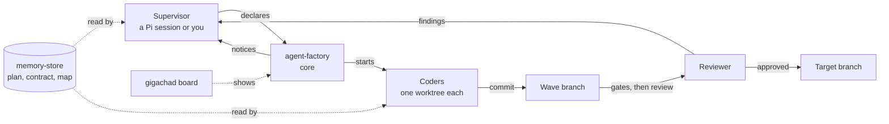
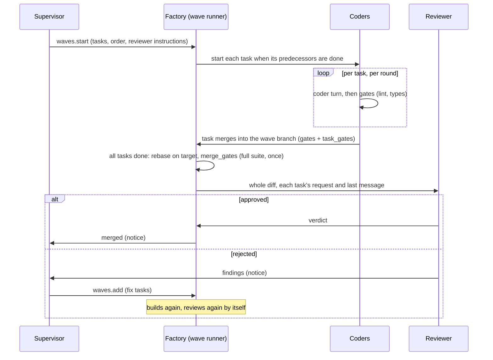
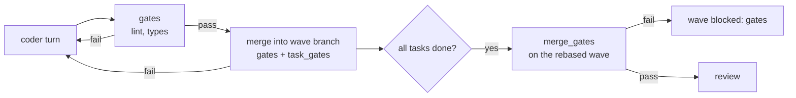
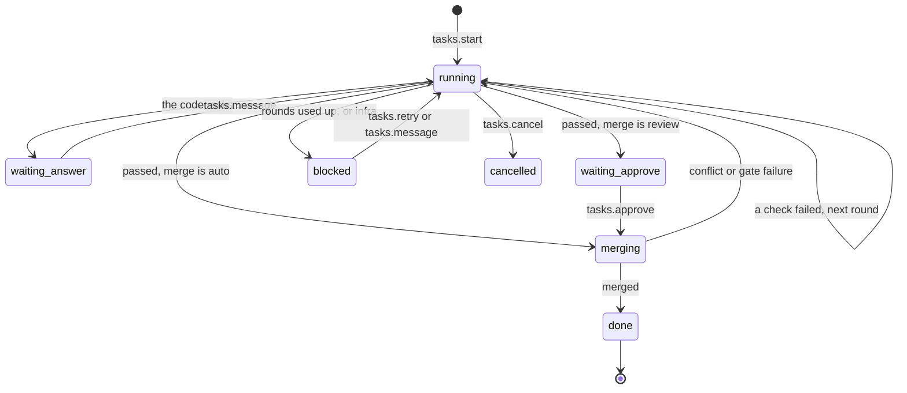

# Agent factory

How coding work runs in the background here: a request becomes a commit that passed checks and review, without anyone
watching. Read the first three sections for the picture, the rest when you change something.
Implementation contracts: `.docs/architecture.md` ("Agent factory" rows). Source map: `.docs/module-map.md`.

## At a glance

- **A task** is one request carried out by a Pi coding session in its own git worktree: code, check, merge. One task
  is one commit.
- **A wave** is a set of tasks declared together. They build on one branch, are reviewed once as a whole, and merge
  into the target branch as a whole.
- **Nothing merges unchecked**: quick checks after every coder turn, tests at every merge, a reviewer per wave.
- **gigachad is a thin client.** The factory is a package of its own and runs with or without gigachad. gigachad adds
  the board, the settings dialog, previews and a revert on removal.
- **No CI server.** The checks a CI would run are `factory/gates.sh`, and the factory runs them before every merge
  ("Checks" below).

## Design rules

The factory's own rules are in its `AGENTS.md` (`~/git/agent-factory`). What they mean for this repository:

- **Two readers, two forms.** What the factory puts into an agent's context (tool results, notices, follow-ups) is
  written for agents and is not changed here. What the user sees is rendered for reading from the event's structured
  data, never by parsing that text
- **The same in every surface.** A factory event has one view model and looks the same in a Pi tab here and in Pi's
  TUI. Readable is the default; a switch shows exactly what the agent has in context
- **Every factory event carries the factory icon**, a notice as much as a tool call
- **The timeline is what happened, in order.** No regrouping. Detail (decisions, merges, rejections, questions and
  the supervisor's answers) lives in the session timeline
- **Above the composer** only what fits without pushing the conversation: the open waves and what waits for a ruling.
  It adds observability, it never replaces a timeline entry
- **Quiet and attention.** What needs a ruling stands out, information is quiet
- **A supervisor run is autonomous.** It never stops for the user; its decisions are recorded and reported at the end
- **Parallel by default.** Waves and tasks run in parallel, also on the same files; contracts settle shared
  interfaces first. The factory, not the supervisor, keeps parallel work in step

## The repositories involved

| Repository | What it is | What it brings |
|---|---|---|
| [`patrickab/agent-factory`](https://github.com/patrickab/agent-factory) (locally `~/git/agent-factory`) | The factory: core, CLI `factory`, MCP server `factory-mcp`, Pi extension, terminal view `factory-tui` | Tasks in worktrees with rounds and gates · waves with one review and one merge · a merge queue per repository · notices into the session that declared the work · a small and a big model per project |
| [`patrickab/memory-store`](https://github.com/patrickab/memory-store) (locally `~/git/memory-store`) | Memory as plain files: JSON fact lists and markdown documents, reached by CLI, MCP or as a Python library | A plan's memory (`plan`, `run/contract.md`, `map`) every agent of a run reads · the descriptions the board shows for a wave · the chat's memory in gigachad · no database, no daemon |
| this repo | The client | Board and task view · factory settings per project · previews of a task's branch · revert of a merged task · `factory.yaml` and `factory/gates.sh` for this repo |

- **Installed from clones.** The `factory` CLI is on pi-host's PATH (or named by env `AGENT_FACTORY_CLI`; production:
  `.docs/deployment.md`, "Provision the agent factory"), and the clone is a Pi package (`pi install <clone>`), so
  every Pi session loads the extension. Merging to `master` in the clone is installing.
- **Factory tasks of this repo cannot change the factory.** A factory change is a commit in `agent-factory` (its
  tests: `bun run test`, `bun run types`). A change to the contract between the two needs a commit in both.
- **Contract with gigachad**: the core's actions (`ACTIONS`, `callAction`, the view shapes, see the package's README),
  which pi-host imports from the path `factory --core-path` prints, and the `preview` setting the core stores for
  gigachad without acting on it.
- **Not installed** (no CLI, a failing one, a core path that does not exist): pi-host answers
  `factory_plugin_missing`; the board and a failed start name the link above.
- **The protocol** a supervising agent follows (plan, contract, waves, retro) is the `parallelize-plan` skill. It is
  not part of either package.

## How a wave runs

- **Declared once**: `waves.start {repo, tag, title, request, tasks: [{key, title, request, after?, model?}]}`. The
  wave's branch is `<target>-<tag with "/" as "-">`.
- **The reviewer only judges.** Findings go to the supervisor, who decides and adds fix tasks. The factory never
  creates fix tasks and never talks back to a finished coder.
- **A wave never waits silently.** Whatever needs the supervisor rests in a state the factory reports
  ("Notices" below).
- **Stages**: `building`, `reviewing`, `rejected`, `merging`, `waiting_approve`, `merged`, `blocked` (reasons
  `conflict`, `gates`, `dirty`, `infra`, `review_failed`), `cancelled`.
- **A task outside a wave** works the same way without the wave's parts: it merges straight into its target, with an
  optional review per round (off by default).

## Checks (the CI)

One script, three moments. `factory.yaml` on the target branch names the commands; a gate is one argv list judged by
its exit code: 0 pass, 75 broken environment (the task or wave blocks as `infra`, no round is spent), anything else
fails and its summary goes back to the coder.

| List in `factory.yaml` | When | Here |
|---|---|---|
| `gates` | after every coder turn | `gates.sh --changed --reuse lint types`: seconds |
| `task_gates` | a wave's task merges into the wave's branch | `gates.sh --changed --reuse`: the tests the change reaches |
| `merge_gates` | once per wave before its review (again at its merge only when the target moved); a task outside a wave at its merge | `gates.sh --changed --reuse` |

- **`factory/gates.sh`** is the one pipeline: local runs, the factory's gates and the check before a redeploy
  (`AGENTS.md`, "Testing"). Call the same script from any CI added later, so both judge the same thing.
  - `--changed`: steps, TypeScript projects, eslint files and vitest tests by the paths changed since the merge base
    with the target. Docs alone run nothing. A path outside the known projects runs everything.
  - `--reuse`: a step that passed on the same tree and merge base is skipped.
  - Hermetic (`env -i`), steps in parallel at low priority, pytest on `cpu_count - 1` workers with a throwaway
    database each. A failed test is rerun once: passing then, the step passes and says `flaky`.
  - Output: a passed step is one line, a failed one a summary (at most 50 lines) and the path of its full log
    (`<git common dir>/check-logs/`, last 20 runs). That is all the coder gets back.
  - Exit 75: missing packages or tools, an empty submodule. Before failing it waits for `node_modules` still being
    copied and refills an empty submodule from the main checkout.
- **`factory.yaml` is read from the target's commit**, never from the tree the coder edits. It and `.factory/**` are
  protected: a coder that changes them gets a round to restore them. An invalid file, or an unknown key in it, blocks
  as `infra`.
- **Hooks**: `after_create` (a new worktree; empty here, `agent-worktree` provides an overlay venv and copy-on-write
  `node_modules`), `after_code` (after every turn), `after_merge` (in the main checkout after a merge that changed a
  lockfile: installs in place, the dev servers may be running from it).

---

Deeper behavior from here on.

## Parts

- **Core** (the package's `src/core.ts` and the `core-*.ts` modules it re-exports): every factory feature as an action
  over plain JSON: `repos.*`, `branches.list`, `settings.get|set`, `config.get|write`, `models.get|set`,
  `tasks.list|get|timeline|diff|start|wait|approve|retry|cancel|remove|message`,
  `waves.start|add|get|list|timeline|retry|approve|cancel|remove`, host-only `tasks.import`.
  State is plain files under `<agent dir>/factory/` (agent dir: `PI_CODING_AGENT_DIR`, default `~/.pi/agent`): task
  records, wave logs (`waves/<id>.jsonl`, append-only, a wave's state is the fold of its events), per-repo settings
  files, task sessions, `notified.jsonl`. There is no daemon.
- **Runners**: a detached process per task (`bun runner.ts`, drives `pi --mode rpc`) and per wave
  (`bun wave-runner.ts`, no Pi session). With `systemd-run` available each runs in a systemd user scope of its own,
  outside pi-host's unit, so a pi-host restart leaves it running. `redeploy.sh` still counts live runners as running
  sessions and does not restart pi-host while one runs. A factory process sees and signals only runners that carry its
  own marker (`FACTORY_MARKER`; unset = the real factory), so a test run cannot touch real work.
- **Pi extension** (the package's `src/pi/`): runs the pipeline inside the task's own Pi session, every step a
  `custom` entry in the session file (the task is rebuilt from them after a restart); gives every Pi session the
  `factory` tool and `/factory` commands; delivers notices.
- **Two views of every answer**: the full view (JSON, stable: board, pi-host, scripts with `factory ... --json`) and
  the agent view (short text lines without paths, timestamps or session ids: the `factory` tool, the MCP tool, the CLI
  by default).
- **pi-host**: `POST /factory/call {action, params}` and `GET /factory/actions` run the core in-process (its path
  asked once from `factory --core-path`; imported again when `core.ts`'s mtime changes, a change in another module of
  the package needs a pi-host restart). A runner it starts inherits pi-host's environment. It never opens or prompts a
  factory session; a change of a task session, record or runner lock under `<agent dir>/factory/` sends
  `sessions_changed`.
- **Backend** (`routes/factory.py`, `lib/pi_host.py`): `POST /api/factory/call` and `GET /api/factory/actions`, a pass
  through (a refusal keeps the core's `detail`). It stores no factory state. Its own parts:
  - a `tasks.start` without `tag` gets the requesting login as its tag (the core would fall back to the host's system
    user), each character the core refuses in a tag replaced by `-`
  - reverting a merged task's commit on `tasks.remove` (`lib/factory_revert.py`: a dry run refuses a conflicting
    revert first, then, once the core removed the task, `git revert` in the repo's checkout; last, because the revert
    reloads the dev server)
  - previews of a task's branch (ports 8100-8199, behind `preview_gate.py`, stopped after a successful `tasks.remove`)
  - images attached to a request or message: `POST /api/factory/images` (`lib/factory_images.py`, stored in
    `~/.cache/gigachad/factory-images/`), their absolute paths appended to the text for the coder to open
  - the move of old Postgres rows into the core at backend start (`lib/factory_migration.py`: settings through
    `settings.set` only when the core stores none, tasks through `tasks.import`; a row is marked once it moved or
    never can, a failed one is retried at the next start)
- **Frontend** (`src/frontend/features/factory/`): board, task view (timeline plus a message box), settings, all
  through `callFactory(action, params)`. `features/pi` shows a session's waves and notices and never imports
  `features/factory`; what both need lives in `lib/domain/factory.ts`.
- **Repo** (`factory.yaml`, `.factory/agents/{coder,reviewer}.md`): hooks, gates, protected paths, preview, role
  prompts.

## A task's lifecycle

1. **Start**: the core makes a worktree off the task's branch, runs `hooks.after_create` and spawns the runner. A task
   never runs in the repo's main checkout.
2. **Rounds**: coder turn → `hooks.after_code` → `gates` → protected-path check → review (when on). A problem goes
   back to the coder as feedback and opens the next round, up to `maxRounds`.
3. **Pass**: `merge: auto` merges, `merge: review` waits for approve. A wave's task always merges into the wave's
   branch by itself; `merge` is then the wave's own.
4. **End**: `done` (merged, or `no_changes` when the diff is empty), else `blocked` with a reason.

- **Questions**: the coder may ask (`factory_ask_supervisor`). The task waits in `waiting_answer` with its
  `question`; the next `tasks.message` answers it and continues the same round.
- **Interrupted**: a task or wave that should be moving but has no live runner. `tasks.retry` / `waves.retry` resume
  it with a fresh round budget.
- **A message to a resting task** opens new rounds. A wave's task can only be continued while its wave is `building`;
  later work goes in through `waves.add`.
- **The coder's prompt** wraps every request with one fixed line: read only what the request names, ignore
  diagnostics about lines you did not change.
- **Tags**: every task has a `tag`, a login or, in a wave, the wave's tag (`plugin/m1/w1`), and may name its plan's
  memory_store (`plan`).
- **Sessions** live in `<agent dir>/factory/sessions/<repo dir name>/`, apart from the user's Pi sessions.
  `GET /api/pi/sessions` drops every session with a `factory` state, so the picker and sidebar never show a task.

## Branches

- Source: the setting, else the repo's default branch (origin's `HEAD`), else `main`, else `master`. Target: the
  setting, else the source.
- A task's worktree is rebased onto its target when a run opens and again at merge.
- A wave's branch is rebased onto the target before its review, without squashing: every task's commit survives.
- Nothing reaches a live wave's branch except through that wave's tasks: `tasks.start` refuses it as a target.

## Merge queue

One per repository, shared by every task's session through ticket files in `<git common dir>/factory-merge-queue`.

1. Commit the worktree, squash to one commit, rebase onto the target. A conflict → `conflict` round, no ticket.
2. Join the queue, first come first served. Status `queued for merge, N ahead`.
3. While waiting, each merge that lands rebases the waiting tasks. A conflict leaves the queue → `conflict` round.
4. On its turn: rebase, the gates of its kind ("Checks"), fast-forward the target (under `flock`).
   - A gate failure → `gates` round on the rebased branch. Nothing merged.
   - The target moved anyway (a merge outside the queue): rebase and retry, 3 attempts.
5. Leave the queue. After a merge that changed a lockfile, `hooks.after_merge` run in the main checkout.

- A ticket whose Pi process ended is dropped by the next reader: a crashed session cannot block the queue.
- Rounds a merge opens count against `maxRounds` like any other.
- Two parallel tasks editing the same file cost a conflict round each. Order them (`after`) when you declare the wave.

## Review

- **Per wave**: on the whole diff since the target, in a worktree on the wave's branch, after the `merge_gates`
  passed. Its prompt holds the wave's `request` (the supervisor's instructions and invariants) and, per done task, its
  title, request and the coder's last message. No time limit.
- **Verdict**: `blocker` and `major` findings reject; `minor` ones pass and are listed with the merged wave.
- **After a rejection** the wave rests `rejected` until the supervisor acts: `waves.add` (builds, then reviews again)
  or `waves.cancel`.
- **Per task** (`review: true`, off by default): the same reviewer per round on one task's diff; its findings go back
  to that coder.

## Notices

The factory tells the Pi session that declared a task or wave (`origin`) whatever needs it, and each notice starts a
turn there. No session has to poll.

| Event | Notice |
|---|---|
| a task asks, is blocked, interrupted, or waits for approve | the task's block with its question or failure |
| a wave is rejected | the findings |
| a wave is blocked, interrupted, waits for approve, or has tasks that can never start | why |
| a wave merged | the commit range and what the review left open |

- Delivered exactly once per event, also across restarts (`<agent dir>/factory/notified.jsonl`).
- Work declared outside a Pi session (the CLI, the board) has no origin: watch the board, or block on
  `factory tasks.wait '{"wave": "<id>"}'`.
- In a Pi tab a notice with a card (`details.card`, version 1; `details.key` names it) shows the card, one without its
  first line that opens to its text (`features/pi/FactoryNotices.tsx`, custom message type `factory-notice`). A
  settled `factory` tool result with a card shows it the same way (`FactoryTool.tsx`), otherwise its row.
- **Cards** (`factoryCard.ts` parses, `FactoryCard.tsx` draws, nothing derived): the factory icon, the title (warning
  ink when `tone` is `attention`, muted when `quiet`), tag, state, progress and cost at the right; opened, its rows,
  findings grouped by severity behind counts (a finding's file opens in the file panel), its text as Markdown. An
  attention card starts open. Kinds: wave, task, scout, proof, contract, decision, action.
- **The switch** (`factoryView.tsx`): readable is the default. Alt+V flips the whole tab to the agent's text (what the
  agent has in context), remembered per tab in `sessionStorage` (`gc.pi.factoryView:<tab id>`); a button on each card's
  row flips that card alone.
- **Decisions**: a `decision` card names the notice it answers (`answers`); while that notice is in the transcript its
  row offers "Show what this answers", which reveals and scrolls to the notice's card, mounting or opening its turn.

## Failures

| Reason | Meaning | What to do |
|---|---|---|
| `max_rounds: <trigger>` | the coder did not fix it within the budget | read the timeline, retry or message |
| `infra: <reason>` | a check exited 75, `factory.yaml` is invalid, or a launch failed | fix the environment, retry |
| `merge_failed` | the fast-forward was refused, usually uncommitted edits in the main checkout on a file the merge touches | commit or stash, retry |
| `rebase_failed: …` | a rebase failed without a conflict (deleted branch, untracked file in the way) | fix, retry |
| `review_<status>` | the reviewer gave no usable verdict | retry |
| `pipeline_error: …` | an unexpected error | read it, retry |
| wave `conflict` | the wave's branch does not rebase onto the target | rebase it by hand and `waves.retry`, or `waves.add` a task that resolves it |
| wave `dirty` | a gate or the rebase left changed or untracked files in the review worktree | `waves.add` a task that fixes the cause, `waves.retry` |

## Settings and models

Per repo in the core (`settings.get|set`, one file per repo, which also registers it), overridable per task or wave:
`merge`, `maxRounds`, `review`, `branch`, `models`, `remote`; `settings.get` answers `{stored, resolved, defaults}`.
`preview` (boolean) is stored there for gigachad only. A task keeps the settings it started with; a wave resolves its
settings once at `waves.start`.

- **Small and big model**: a wave's task declared `model: "small"` runs on the project's small model, everything else
  and the reviewer on the big one. `coder` and `reviewer` are the stored names; `big` is an alias of `coder`.
  With nothing stored a task runs on Pi's session model. The package's `defaults.yaml` only says what `small` means
  where a project names none.
- **The settings dialog** shows two pickers, Small model and Big model. It reads big as `big ?? coder` and saves
  `models: {small, big, reviewer: <big>}`, an empty picker leaving its keys out.
- **Factory models** (`models.get|set`): the list of `provider/model` ids tasks and settings may use.
- **`remote`** (off by default): push a wave's branch, open its pull or merge request (`gh`, `glab`), comment each
  verdict, push the target after the merge. A failure is recorded and never blocks the wave.

## Observability

- **Board** (sidebar, Pi section, a repository's factory icon; per repository): three columns, Working, Merging,
  Finished. What waits on the supervisor or the user sits in a Waiting block atop Working, absent while nothing waits
  and outside Working's count. The gap between columns is one shared, draggable value
  (`localStorage` `gigachad:factory-column-gap`).
- **Cards on the board**: state, round, blocked reason, the open question, tokens in and out, cost (coder plus reviews).
  Tokens in count cache reads; cost is the provider's figure. Cards in a Pi tab's transcript: [notices](#notices).
- **Waves on the board** (`waveTree.ts`, `WaveTree.tsx`): built from `waves.list`, read with `tasks.list` on the same
  refresh events. A wave is a container inside a column (`waveColumn`): `building` (once a task of it is done),
  `reviewing`, `merging` in Merging; `rejected`, `blocked`, `waiting_approve` or interrupted in the Waiting block;
  `merged`, `cancelled` in Finished, closed by default. Inside: its done tasks, a link to the declaring session, the
  outcome (`WaveOutcome.tsx`: reviews newest first with findings and a link to the reviewer's session, failed gate
  runs, the merged commit range, the remote request's link). Its description is the document `plan/<tag or prefix>.md`
  of the plan's memory_store, read when its toggle opens (`GET /api/memory/read`). Waves of one column sharing a tag
  prefix are wrapped in one container per prefix segment; a group holding a single wave has no container of its own.
  A factory without `waves.list` (`unknown action`) shows no waves and no error.
- **Waves in a Pi tab** (`features/pi/SessionWaves.tsx`): above the composer, one `Factory` element for the waves the
  tab's session declared, in whatever repository (`waves.list` without a repo), at most 40% of the view high, scrolling
  beyond. Its header counts the active waves, the cards that need the user (warning colour) and the active waves' cost,
  or `<n> finished` without active ones, and collapses the element (open while a wave is active). `<n> needs you`
  counts the transcript's attention cards that no decision answers, in the transcript or from `decisions.list`
  (`origin`: the session). A `Decisions · <n>` entry lists the session's decisions, each jumping to the card it answers
  while that card is in the transcript (entries without a valid card are dropped). Active waves come first, those needing the user at the top; merged and
  cancelled waves sit behind one collapsed `<n> finished` row. Every wave opens to its tasks, unfinished ones first:
  the coder's model (from `tasks.list`), tokens in and out, state. A started one has a button that opens its task view
  (the coder's session, brief and handoff). Without waves, decisions or waiting cards it is absent.
- **Timeline** (task view): per round the trigger, the coder's turn (model, tokens, cost, last message), its
  questions, each gate with duration and failed output, the review with findings, the merge.
- **Terminal**: `factory-tui` (read-only), or `factory waves.list`, `factory tasks.list`, `factory waves.get`.
- **Logs**: the backend logs failed or slow (> 5 s) pi-host calls, pi-host slow RPCs, requests and event-loop stalls.
  A runner logs next to its record under `<agent dir>/factory/`.

## New repo

A repo needs a committed `factory.yaml` once, drafted in either of two ways from the same generator (the package's
`draft.ts`, no model):

- **Plain Pi**: `/factory init` in a session of the repo writes the draft into the main checkout, uncommitted, and
  reports which file the gates were detected from. It refuses to overwrite an existing `factory.yaml`.
- **gigachad**: opening the board of a repo without one shows the draft (`config.get`) in an editable text area. Save
  (`config.write`) writes it uncommitted into the main checkout. New task stays disabled until the file exists.

Review and commit it: tasks pick it up from that commit on.

- **Draft**: fills the commented template with `gates` (lint, types, format) and `merge_gates` (everything, tests
  included). The highest-level source wins: `factory/gates.sh`, Makefile targets (`lint`, `typecheck`, `check`,
  `test`), `.gitlab-ci.yml` scripts, then `.pre-commit-config.yaml`, `package.json` scripts and `pyproject.toml`
  together. From GitLab CI only lint-like and test-like stages count. Nothing found: the template as it is.
- Add `task_gates` by hand when the repo has a way to run only the tests a change reaches.
- Set the factory models before the first task (`factory models.set`, or `/factory models add <id>`).
