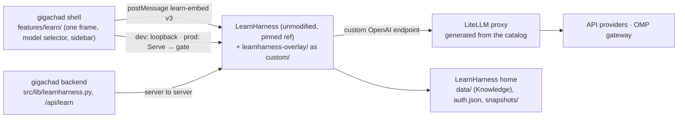

# LearnHarness integration (learn mode)

Everything about learn mode: why it exists, the decisions behind it, how it is built, the rules for changing it, operations, and what a future agent needs to know. Read this file only when working on learn mode. Sibling for the omp tabs, whose pattern learn mode follows: `.docs/integration-ompweb.md`. Planning history (PRD, tickets, contracts, slice reports, reviews, upstream proposal drafts): `~/git/gigachad-bot/.wayfinder/learnharness-integration/` (gitignored, local only).

## Goal

- The user studies difficult material in gigachad. [LearnHarness](https://github.com/amosblomqvist/learnharness) (LH, AGPL-3.0-only, Next.js + pi SDK, JSON/JSONL files) does what gigachad's tutoring prompt cannot: probe what the learner knows, plan a dependency tree of concepts toward a goal, teach with checked understanding (quizzes, predictions, recall), and keep a global Knowledge graph across sessions. It improves weekly.
- **The user's goal: receive every LearnHarness feature as upstream ships it, with gigachad's UI customized as far as that allows.** No fork, no copy. Upstream releases arrive by themselves: each start serves the newest release tag the overlay checks pass against ("Bumping the ref"), a pinned ref holds a version. Every LearnHarness function stays reachable, only the UI around it differs.
- Learn mode is host-only and single-learner. Knowledge is global and owned by LearnHarness: gigachad chat sessions never read it, gigachad never feeds it (PDFs and notes go in the LearnHarness way).

## Decisions

| # | Decision | Why |
|---|---|---|
| D1 | LearnHarness runs **unmodified** as a sidecar at a pinned ref, plus a private overlay copied in as `custom/` and a seam patch of a few lines, like omp-web ([ADR 0001](adr/0001-learnharness-as-unmodified-sidecar.md)) | A fork would turn every upstream change into maintenance |
| D2 | gigachad-bot is AGPL-3.0-only, plus a section 7 permission for MinerU (`LICENSE`, `LICENSE-EXCEPTION`, [ADR 0002](adr/0002-agpl-3-0-only.md)) | License-clean overlay and upstream contributions; MinerU >= 3.1 adds a usage threshold AGPL does not allow |
| D3 | **Hide and drive** (the omp-web way): gigachad's model selector, sidebar and look drive LearnHarness's hidden UI through upstream's own writes, events and dialogs | Maximum UI customization without reimplementing LearnHarness logic |
| D4 | **LearnHarness's own composer, docks and stats bar stay** (restyled). A shell composer was built and then dropped | It coupled to an untyped upstream quirk (sync ref read on send), needed a restore rule, insets CSS on unlabeled dock markup, modal dimming and key forwarding: about 900 lines for little gain |
| D5 | **gigachad's model selector stays** (model drive), LearnHarness's model pills are hidden but mounted, the session model is frozen (read-only) | The user picks from gigachad's catalog in gigachad's UI; one session is taught by one model |
| D6 | **LearnHarness's sidebar and title bar are hidden**: the session title is the tab name, learn sessions are a category in gigachad's sidebar, and every feature they offered has a shell path (feature table below) | User decision. Cost: every new upstream feature in those surfaces needs a shell path, the inventory guard fails until it has one |
| D7 | Prefer **opening upstream's own UI inside the frame** (popups, panels, dialogs) over re-rendering it in the shell. Plain data and API actions go through the backend adapter | Upstream keeps rendering and evolving it |
| D8 | Models only from gigachad through a **LiteLLM proxy sidecar** generated from one login's catalog; LearnHarness gets no provider key, endpoint or subscription UI | One place for keys and models; any keyed builtin provider would add its models to LearnHarness's menus |
| D9 | LearnHarness's 3 tiers kept: **strong** (prober, teacher; picked per draft, stamped per session), **cheap** (researcher, demo builder, extractor, auditor) and **vision** (visual maker, PDF reader), the latter two in LearnHarness Settings → Agent | Context-heavy background work stays affordable, figures and PDFs need an image model |
| D10 | LearnHarness runs in a **sandboxed user unit** (environment allowlist, `InaccessiblePaths` denylist, private HOME); production adds a host-capability gate | Its agent reads any absolute path and has no auth |
| D11 | Projects group learn sessions (`learn_sessions` in `project.json`); deleting a project deletes its sessions with `preserve-graph`, Knowledge stays. Sessions opened from a project join it | Like chats, without losing what was learned |
| D12 | "Learn this": chat tool `start_learn_session(goal)`, the chat model condenses the conversation into the goal, the session uses LearnHarness's current strong tier | Move from exploring to learning without retyping |

## Integration at a glance



- **Upstream as is, in the frame**: transcript and its rendering, composer, question and practice docks, stats bar with per-turn popover, home and graph, practice, settings dialog, setup flow, Plan/Coverage/activity panels, all keyboard shortcuts.
- **Restyled by CSS** (`html.cf-embed` only, standalone LearnHarness keeps its look): gigachad's palette, fonts (Outfit, JetBrains Mono for code), type and radius ladders, markdown and code styling through a thin `MessageResponse` wrapper.
- **Driven by the shell**: model and thinking selection (top bar), the session list and its actions (gigachad sidebar), Plan button, theme, navigation, settings entry, modal dimming.
- **Removed from LearnHarness's UI**: provider, key and subscription screens (models come only from gigachad).

## Architecture: gigachad's UI drives LearnHarness

LearnHarness runs unmodified in one iframe. Its teaching, sessions, composer, docks, transcript, stats bar and settings dialog stay upstream's. gigachad's shell takes over the model selector and the chrome around them, the omp-web way ("hide and drive"):

- **Shell** (`src/frontend/features/learn/`): the model and reasoning selectors sit in the learn top bar (`LearnModel`), next to a Plan button on sessions with a plan (`LearnPlanButton`, upstream's PLAN chip, sharing `useLearnPanels` with the sidebar menu), learn sessions are a category of gigachad's sidebar (`LearnSidebar`: rows, chips, filter, rename, delete, export, panels, background agents), the session title is the tab title.
- **Frame** (`learnharness-overlay/`): upstream's composer and stats bar stay visible and work as upstream's, restyled by the look CSS. Upstream's model pills, sessions sidebar and session title bar render as before, but in **drive mode** stay mounted and hidden (`hidden`, `inert`, `display: none`). The shell drives them through upstream's own writes, events and dialogs, and they report their state back. Their logic (the send guard's model, `onModelChange`, settings dialog) keeps running.
- **Drive mode** (`html.cf-shell-drive`) starts only after a version-matched handshake (`ready`/`hello` carry `LEARN_PROTOCOL_VERSION`). A mismatch (one side restarted with another protocol) leaves upstream's UI fully visible in the frame and the shell shows "LearnHarness needs a restart", with no shell model selector.
- **Protocol** (`packages/chat-ui/src/learn-protocol.ts`, v3, channel `learn-embed`): shell → frame `hello`, `set-theme`, `open-session`, `new-session {kind}`, `open-home`, `set-model`, `set-thinking`, `open-settings {section}`, `open-panel {panel, sessionId}`, `close-modal`. Frame → shell `ready`, `view`, `model`, `models`, `model-open`, `modal`, `session-meta`, `session-plan`, `activity`, `chrome-key`. `IS_STATE` says which are replayed state (the frame replays them on every `hello`), `ANY_VERSION_SHELL_MESSAGE` which work without a version match (theme and navigation). Both sides validate every message and drop malformed ones.
- **Backend** (`src/lib/learnharness.py`, `/api/learn`): the session list with row states, create and first turn ("Learn this" tool), rename, delete (`preserve-graph` or `delete-nodes`), Markdown export, project mapping.

## Map

```
~/git/gigachad-bot/                        gigachad-bot checkout (master), run.sh serves it
  learnharness-overlay/                    private overlay, becomes custom/ in the served LearnHarness
    root.tsx, framing.ts, next.config.ts     entry (CustomRoot), frame-ancestors CSP, module overrides (withCustom)
    embed/                                 bridge, channel, drive mode, routes, theme, settings guard, and the drivers:
                                             model.tsx (model bridge), freeze.ts,
                                             chrome.tsx (hidden chrome, session-meta, activity, panels, modal)
    overrides/components/                  hide-and-drive overrides: model-picker, sidebar, top-bar,
                                             ai-elements/message (gigachad markdown wrapper)
    theme/                                 embed-only CSS: palette, tokens, fonts, type and radius ladders, prose,
                                             chrome, hidden Providers UI
    seams.patch                            the upstream lines that load the overlay (app/layout.tsx, next.config.ts)
    *.test.mjs                             overlay tests (node:test + jiti, run in a check checkout), inventory.test.mjs
                                             is the upstream-feature inventory
  src/frontend/features/learn/             shell adapter: frame, bridge, provider, model, sidebar, tabs, tool link
  src/frontend/packages/chat-ui/src/learn-protocol.ts   the postMessage protocol, shared by both sides
  src/lib/learnharness.py                  backend adapter (sessions API) and the model generator (write-config)
  src/backend/routes/learn.py              /api/learn (host only): sessions, rename, delete modes, export, projects
  src/backend/learnharness_gate.py         production Tailnet gate in front of the frame
  run-learnharness.sh                      builds and serves LearnHarness in its sandbox unit, refuses an unguarded ref
  run-litellm-proxy.sh                     generates the model config, serves the LiteLLM proxy

~/git/learnharness/                        upstream clone amosblomqvist/learnharness, never edited for gigachad
~/.local/share/gigachad-bot/learnharness-upstream/   served worktree (D), owned by run-learnharness.sh, never edit by hand
~/.local/share/gigachad-bot/learnharness/            LearnHarness home: data/, auth.json, snapshots/, served-commit, home/ (private HOME), tmp/
~/.local/share/gigachad-bot/litellm-proxy/           proxy home: config.yaml (generated), master.key
```

## Where a change belongs

| Change | Place | Ships via |
|---|---|---|
| What the frame hides, reports or does on a shell message | `learnharness-overlay/` (`embed/`, `overrides/`, `theme/`) | gigachad-bot commit, next LearnHarness restart (rebuild) |
| The postMessage protocol | `learn-protocol.ts`, both sides in the same commit | same gigachad-bot commit (the launcher packs chat-ui) |
| Shell side (selectors, sidebar rows, tabs, tool link) | `src/frontend/features/learn/` | gigachad-bot commit, frontend hot-reloads |
| Which LearnHarness API the backend calls, its shapes | `src/lib/learnharness.py` only, routes map its errors | gigachad-bot commit, backend restart |
| Models LearnHarness offers | the generator in `src/lib/learnharness.py`, served by `run-litellm-proxy.sh` | next proxy start |
| Sandbox, environment allowlist, build, upstream markers | `run-learnharness.sh` | next LearnHarness restart |
| LearnHarness lacks a seam or has a bug | upstream issue or pull request to amosblomqvist/learnharness (drafts: `.wayfinder/learnharness-integration/spec/upstream-proposals.md`), then bump the ref | ref the launcher serves |
| LearnHarness's server API, sessions, teaching logic, storage | never | n/a |

## Overrides: the upgrade-safety rules

An override is `learnharness-overlay/overrides/<path>`, replacing upstream `<path>` for every importer (`next.config.ts` `withCustom`). Hide-and-drive overrides are allowed under these rules, each enforced by a test or `tsc`:

- **Wrap, never copy**: `export * from` the upstream module by relative path (`../../../components/X`), then shadow only what changes, typed against upstream's exports (`ComponentProps<typeof Upstream>`). Never hand-list re-exports. Inventory check 2 fails on an override without `export *` or missing an upstream export.
- **Hidden, still mounted**: hidden upstream UI stays rendered (`hidden`/`inert`), its logic keeps running. Never delete it.
- **Hiding keyed to our markers**: CSS hides only what our overrides mark (`data-cf-*`) or what sits under `html.cf-shell-drive`, never upstream class names. Where an upstream surface must be told apart, the marker is set by content (the sessions sidebar is the `<aside>` holding `data-testid="new-session"`, the title bar the TopBar holding `phase-chip`): if upstream drops the content, the surface stays visible. A surface we did not override stays visible.
- **Exhaustive tables over upstream unions**: every upstream `KeyAction` is classified in `inventory.test.mjs` `KEY_ACTIONS` (frame, chrome key, model menu, frozen), and the `TopBar` props are mapped there (type checker), so a new shortcut or prop fails a test.
- **Server/client rule** (from slice E): an override that a server component imports (today only `components/sidebar`, via `app/layout.tsx`) has no `"use client"` and no JSX: only `export *` plus re-exports of client wrappers that live in a client module under `embed/` (`embed/chrome.tsx`). Otherwise the server sees the star exports as undefined, or the wrapper renders twice (the server's client reference resolves to the override). Every other override is a normal `"use client"` module.
- **Alias rule**: `overrideAliases` registers `@/X`, `@/X.tsx`, `@/X.ts` and the bare sibling `./X` only. Never a suffixed sibling key (`./X.tsx`, `./X.ts`): Turbopack lets it capture `./embed/X` and `@/custom/embed/X` too. Inventory check 2 fails on an upstream import of an overridden module the aliases miss (e.g. `../model-picker` from a subdirectory) and on a bare `./X` key that would capture another module.
- `seams.patch` stays at the lines that load the overlay.

## Feature table

Every LearnHarness v0.4.0 feature, and where it lives in learn mode: upstream's own UI in the frame, or a shell path for what the hidden UI offered. "Live" = exercised in a browser against a real LearnHarness by the slice that built it (reports in `.wayfinder/learnharness-integration/reports/`); "upstream" = upstream's own UI, untouched by the overlay.

| Upstream feature | Path | Live |
|---|---|---|
| Composer: send, steer while running, Stop, Esc aborts a turn | upstream's `Composer` in the frame | yes |
| Refused send (setup, unavailable model, dock busy), opening-prompt failure | upstream's, in the frame | upstream |
| Question and practice docks, Retry, continue, "Next problem" | upstream's, in the frame | upstream |
| Dictation (mic) | upstream's, in the frame's stats bar and docks; the frame may use the microphone (`allow="microphone"`) | upstream |
| ⌘F find, ⌘T toggle all thinking, ⌘G graph, new session, ⌘, settings, cheat sheet, dock keys | upstream's, pressed in the frame | upstream |
| ⌘K model menu | in the frame: the freeze turns it into `model-open`, the shell's selector opens (never on a session's read-only pill) | yes |
| ⇧Tab thinking | in the frame: upstream's hidden control cycles the draft's strong tier; swallowed on a session (read-only) | unit tests |
| Home, graph | upstream's, restyled; also the "Open knowledge graph" learn header action → `open-home` | yes |
| Draft model + thinking (strong tier) | top-bar selector filtered to served models → `set-model` / `set-thinking` → upstream's write | yes |
| Session model (frozen) | read-only pill; an unavailable model turns it back into the selector | yes |
| Model pills in the stats bar | hidden by the model-picker override in drive mode, the top-bar selector stands in | yes |
| Cheap and vision tiers, every other setting | learn header Settings → `open-settings` → upstream's dialog | yes |
| Stats bar: context · cost, per-turn popover | upstream's, visible in the frame | yes |
| Title display | tab and row title from `session-meta` | yes |
| Rename (title bar click, sidebar inline, F2) | row pencil, double-click, rename dialog; F2 in the shell or in the frame (`chrome-key`) | yes |
| Plan chip → full-plan popup | row menu "Plan" (when `session-plan` says so) → `open-panel plan` → upstream's PlanPopup | yes |
| Coverage ring + popover, session menu coverage block + Extract now | row menu "Coverage" → card with upstream's `CoverageRingDetail` and `CoverageMenuBlock` | yes |
| Phase chip / Practice tag | row chip | yes |
| Row states: working / waiting / problem waiting / compacting + age | row chip from `session-meta.status`, else the list fields | working yes, others unit tests |
| Export as Markdown | row menu → `GET /api/learn/sessions/{id}/markdown` → download | yes |
| Delete (preserve graph) | row trash + undo | unit tests |
| Delete with "Also remove its graph traces" | row menu "Delete with graph traces" → undo → `DELETE ?mode=delete-nodes` | yes |
| Delete navigates away from the open session | tab → learn home, the frame's open page → `/` | yes |
| Background agents: list | "background agents" folder (`activity`) | yes |
| Background agents: detail, cost, elapsed time, stop | folder action → `open-panel activity` → upstream's `ActivitySection` | yes |
| Teaching / Practice / All filter, fuzzy search, ↑/↓, Enter | filter row with upstream's ranking and `PillTabs` | yes |
| ⌘⇧F sessions search, ⌘B sidebar | `chrome-key` → shell filter / shell sidebar | yes |
| New Teaching / New Practice | learn header actions → `new-session {kind}` | yes |
| Settings dialog, setup dialog, any modal | upstream's, in the frame; the shell dims its chrome with a hole over the frame (`modal`), a click on the dim or Esc closes it (`close-modal`) | yes |
| Home (graph, teach/practice switch, its composer) | upstream's, restyled | yes |

### Accepted gaps

- **Shell attachments**: gigachad's documents and images never reach a learn session, LearnHarness takes what its own composer takes. Dictation is keyless in learn mode (no Deepgram key in the sandbox).
- **Shortcut rebinding**: LearnHarness's keymap (`lh:keymap`) applies in the frame only.
- **Draft model pick is global**: it moves LearnHarness's strong tier for every draft and tab, running sessions keep their stamp.
- **Catalog lag**: a new gigachad model reaches LearnHarness on the next proxy start.
- A coverage or activity card stays open until Escape or a click inside the frame (the frame cannot see a press in the shell). A row's Plan entry appears once the frame has shown that session.

## Upgrade guards

What fails when upstream changes something learn mode relies on, and where:

| Guard | Catches | Runs |
|---|---|---|
| `tsc --noEmit` | a renamed or removed export, a changed prop type | check checkout |
| `inventory.test.mjs` check 2 | an override without `export *` or missing an upstream export, an upstream import that bypasses the aliases, a bare alias key capturing another module | check checkout |
| check 3 | a new or removed keyboard action (`KEY_ACTIONS`), the hidden chrome's keys out of step with `LEARN_CHROME_KEYS` | check checkout |
| check 5 | a new or removed `lh:` event, shortcut or storage name; an `lh:` name the overlay uses that upstream dropped | check checkout |
| check 6 (`look.test.mjs`) | a type or radius rung without gigachad's value | check checkout |
| check 7 | an upstream API path the overlay calls that no route serves | check checkout |
| props, hidden chrome | a new `TopBar` prop; a new control (test id, aria label, Hint, component, or an unnamed button/input/handler) in the hidden sidebar or title bar without a shell path | check checkout |
| markers, exports | a content marker, test id or data attribute the overlay keys to, or an upstream export it imports, gone | check checkout |
| launcher markers (`run-learnharness.sh` `upstream_markers`) | the served ref lacks a name or URL the overlay or the backend adapter relies on: refused before install or build ("the learn-mode overlay needs updating for this ref") | every LearnHarness start, and with tsc and the overlay tests against every release the automatic update considers |
| `chrome.test.mjs`, `model.test.mjs`, `freeze.test.mjs`, `embed.test.mjs` | behaviour of each driver against upstream's real modules | check checkout |

The spike's checks 1 and 4 (input types, composer-like call sites) are retired: every input surface is upstream's own and visible.

A failing guard means "a feature moved": give it a shell path (or a frame action that opens upstream's own UI, or leave it visible upstream), then update the table entry and this runbook's feature table. Never delete an entry to make a guard pass. Each guard was proven once to fail by mutating a check checkout (the slice reports).

## Workflows

### gigachad-bot change (overlay, protocol, shell, adapter)

1. Edit in `~/git/gigachad-bot` on `master`. `run.sh` serves this checkout's overlay and chat-ui.
2. Protocol change: handle the message on both sides (`embed/channel.ts` + the driver, `features/learn/bridge.ts`) in the same commit, keep `IS_STATE` and `ANY_VERSION_SHELL_MESSAGE` exhaustive. A breaking change bumps `LEARN_PROTOCOL_VERSION`.
3. Shell checks (`src/frontend`): `npx tsc --noEmit`, `npx eslint .`, `npx vitest run features/learn features/navigation`.
4. Backend: `.venv/bin/python3 -m pytest -q tests/test_learnharness_sessions.py tests/test_learnharness_models.py tests/test_learnharness_gate.py tests/test_learnharness_launcher.py tests/test_litellm_proxy_launcher.py`.
5. Overlay checks need a private check checkout (below). Never rsync into the served worktree D: another agent's overlay would be replaced, and the launcher owns it.

### Private overlay check checkout

```bash
task=<task>; G=~/git/gigachad-bot; C=~/.local/share/gigachad-bot/learnharness-check-$task; ref=v0.4.0
git -C ~/git/learnharness worktree add --detach "$C" "$ref"                      # once per ref
cd "$C" && ELECTRON_SKIP_BINARY_DOWNLOAD=1 npm ci && git apply "$G/learnharness-overlay/seams.patch"   # once
# every check:
rsync -a --delete "$G/learnharness-overlay/" "$C/custom/"
T=$(cd "$G/src/frontend" && node packages/chat-ui/pack.mjs --out "$C/node_modules/.gigachad-chat-ui") \
  && npm install --no-save --no-audit --no-fund --ignore-scripts "$T"
node_modules/.bin/tsc --noEmit && node --test custom/*.test.mjs
GIGACHAD_LEARNHARNESS_FRAME_ANCESTORS=http://127.0.0.1:<shell port> NODE_ENV=production npm run build
# done: git -C ~/git/learnharness worktree remove --force "$C"
```

`npm run build` catches what `tsc` does not (Next config, CSS imports, Turbopack aliases, prerender of server components). The frame ancestors are baked into the build: a live check from another shell origin needs its own build.

## Bumping the ref

LearnHarness keeps no backward compatibility for stored data, and its UI moves fast. Two paths: the launcher's automatic update, which follows upstream's releases, and a manual bump, which pins a ref after a human review.

### Automatic path (default)

With `GIGACHAD_LEARNHARNESS_REF` unset, every real start of `run-learnharness.sh` (`run.sh` in development; in production `gigachad-bot-learnharness.service` via `deploy/run-production-learnharness.sh server`, which `redeploy.sh` restarts) updates before it serves. A LearnHarness already listening is reused untouched: the update applies at its next start.

1. `git fetch --force --tags origin` in `GIGACHAD_LEARNHARNESS_REPO` (120 s limit, no prompts).
2. Release tags (`v*`, version order) newer than the last working commit (`served-commit`, the commit that last listened) are tried newest first. Each is checked in the launcher's check checkout `GIGACHAD_LEARNHARNESS_DIR-check` (a second detached worktree that keeps its `node_modules`): `seams.patch` applies, the launcher markers, `tsc --noEmit`, `node --test custom/*.test.mjs`, from the build's allowlisted environment. The first that passes is served.
3. Results are kept per commit and overlay digest in `update-checks/` in the LearnHarness home (a failure with its `.log`), so an unchanged upstream costs only the fetch and an overlay fix checks the release again. A failed install (network) is not kept, it is retried next start.
4. The pre-bump snapshot (below) runs before the worktree moves. If the accepted release still fails its install or build, the launcher records it as failed and serves the last working commit again.
5. A failure never blocks the start: offline, a failing check or build serve the last working commit and print one line saying why, e.g. `LearnHarness not updated, serving v0.4.0 (dc4c398): v0.5.0 failed tsc (log: …)`. A switch prints `LearnHarness update: <old> -> <new>`. `GIGACHAD_AUTO_UPDATE=0` skips the update (no fetch, no checks).
6. `redeploy.sh` asks `run-learnharness.sh --select` (prints the commit a start would serve, running the checks while LearnHarness keeps serving) and restarts LearnHarness when that differs from `served-commit` and no session is busy.

The checks are an automatic gate, not a review: after an update, walk steps 1, 3 and 4 below when convenient and smoke one learn tab. A release failing a check needs an overlay fix (its log names the check), the next start then takes it.

### Manual path (pinned ref)

For a commit that is no release tag (`origin/main`), or to hold a version. Go through these in order, stop at the first failure:

1. **Read** upstream's changes between the refs (`git -C ~/git/learnharness log --oneline <old>..<new>`), especially storage, `app/api/chats`, `app/api/chat`, settings, `components/{chat,model-picker,sidebar,top-bar}.tsx`.
2. **Check checkout** at the new ref (above): `tsc`, every overlay test, `npm run build`.
3. **Guards**: every failure in "Upgrade guards" is mapped (shell path, frame action or upstream-visible) before going on. Also run the launcher's marker list against the new ref: the launcher refuses it otherwise, so a fixed list is part of the same commit. Recheck what lives outside the overlay: the chat API shapes in `src/lib/learnharness.py`, the credential routes the gate refuses (`app/api/keys`, `custom-provider`, `subscriptions`), the `settings.json` keys and `auth.json` binding record the generator writes.
4. **Live smoke** on your own stack, never the served one: LearnHarness from the check checkout on a spare bind with a scratch home (copies of the served `settings.json`/`auth.json`), the work tree's backend and a frontend copy on spare ports, all through `agent-proc`, throwaway sessions only, everything stopped afterwards. Walk the feature table: upstream's composer sends and steers, the stats bar and its popover show without model pills, ⌘K in the frame opens the shell selector, draft model pick moves the strong tier, session pill read-only, rows and chips, rename, Plan/Coverage/activity panels, export, delete with and without graph traces, filter, settings, modal dimming, a frame at the old protocol version shows upstream's UI and the restart banner.
5. **Production**: set `GIGACHAD_LEARNHARNESS_REF` (in `$ENV`) and restart LearnHarness when no session is busy (`curl -s http://127.0.0.1:30181/api/chats`, no `busy: true`). `redeploy.sh` does this when the ref moved. Smoke one learn tab. A pinned ref is never updated and its failure ends the start (no fallback). Unset it to return to the automatic path.

**Pre-bump snapshot.** On a start at another commit than `served-commit` (automatic or pinned), the launcher first copies `data/`, `auth.json` and the `*-credentials.json*` files to `snapshots/<old-sha>-<utc>/` in the LearnHarness home. A snapshot identical to the newest one for that commit is not taken again, so retrying a failing bump keeps one copy. `served-commit` moves only once the new commit listens. Rolling back: stop LearnHarness, copy the snapshot back into a fresh home, write the old sha to `served-commit`, pin the old ref (`.docs/deployment.md`, "Roll back safely"). The daily backup is separate and keeps working copies too.

**Launcher markers.** After copying the overlay, before any install or build, `run-learnharness.sh` checks every `file|text` in `upstream_markers` (the overlay's exports, content markers and URLs, the backend adapter's routes and delete modes) plus the `lh:kbd-*` names `embed/freeze.ts` swallows, and refuses the ref when one is missing. Update the list with the overlay, never remove an entry without removing the code that relies on it.

## Sandbox

`run-learnharness.sh` runs LearnHarness as the transient user unit `gigachad-learnharness-<port>` (`systemd-run --user`, `UMask=0077`), because its agent reads any absolute path:

- **Environment allowlist** (`env -i`): `PATH`, `HOME` (private, `<home>/home`), `LANG`, `NODE_ENV`, `LH_DATA_DIR`, `LH_AUTH_FILE`, `TMPDIR`, `CHROME_PATH`, `GIGACHAD_LEARNHARNESS_FRAME_ANCESTORS`, `XDG_RUNTIME_DIR`, `DBUS_SESSION_BUS_ADDRESS`, `BRAVE_API_KEY`, `CUSTOM_OPENAI_API_KEY` (the proxy's master key). Never provider keys: one would list that provider's models in every LearnHarness menu. Never `LH_DESKTOP_*`: they lock the frame out of LearnHarness's API.
- **Denylist** (`InaccessiblePaths`, absent paths skipped): `~/.secrets`, `~/.ssh`, `~/.omp`, `~/.gnupg`, `~/.config/gh`, `~/.aws`, `~/.netrc`, `~/.git-credentials`, the proxy home, `~/.claude`, `~/.claude.json`, `~/.codex`, opencode's config and data, `~/.local/share/keyrings`, `~/.password-store`, `~/.docker`, `~/.kube`, `~/.config/gcloud`, `~/.azure`, `~/.npmrc`, `~/.pypirc`, `~/.var/app` (flatpak app data, the user's Chrome profile), `~/.config/google-chrome`, `~/.mozilla`, and the `.env*` files of this checkout and the main checkout. A new credential store on the machine belongs on this list. A denylist is incomplete by nature, an allowlist (`ProtectHome=tmpfs` plus bind mounts) is the open alternative.
- **Demos** run in flatpak Chrome through a wrapper (`<home>/chrome`) that shares `TMPDIR` with flatpak's private `/tmp`. flatpak needs the user session bus. Known risk: the bus and the user manager are reachable from inside, so code execution in LearnHarness could leave the sandbox with `systemd-run --user`. Node and npm must not be mise shims (a shim exits 1 under the private `HOME`).
- `npm ci` and `next build` run outside the unit with an allowlisted environment (no provider keys).
- Stopping the launcher stops the unit (its `EXIT` trap). Check a change with `nsenter -t <MainPID> -U -m --preserve-credentials` and the process's environment, as in the launcher tests.

## Models: generator and proxy

- `python -m lib.learnharness write-config` (run only by `run-litellm-proxy.sh`, right before the proxy starts) reads one login's catalog (`GIGACHAD_LEARNHARNESS_LOGIN`, else the OS user; read-only lookup) and writes, under a lock, staged and renamed:
  - `config.yaml` in the proxy home: one route per model, named by its gigachad selector string. No secret: `os.environ/LITELLM_MASTER_KEY`, `os.environ/GIGACHAD_OMP_GATEWAY_TOKEN` and provider keys by name, exported by the proxy launcher only;
  - LearnHarness's `settings.json`: `customProvider` (base URL, binding id, models with capabilities, `context` and `maxTokens`, assumed 128000/16384 when unknown) and the `strong`/`cheap`/`vision` tiers only when absent. Every other key is untouched;
  - the `auth.json` binding record, without the key.
- A served model's LearnHarness id is its gigachad selector string, so the shell's selector offers exactly `models.served` and sends the selector string back.
- A transient failure (gateway, OMP registry, Ollama, database, unknown login, empty catalog) writes nothing and exits 1: the last configuration stays.
- The proxy listens on `127.0.0.1` or `localhost` only. `uv tool run` serves the LiteLLM version `uv.lock` pins (`proxy-tool-pin`), never from the project venv.
- A catalog change reaches LearnHarness on the next proxy start, never by itself. A reused proxy is checked (`check-proxy`): a refused master key or another model list prints a "stale or mismatched" warning; stop it and rerun.
- In production the proxy unit reads the production database (`deploy/run-production-learnharness.sh proxy`), and `redeploy.sh` restarts the proxy on every redeploy when no session is busy.

## Shell contracts

- **Keyboard**: upstream's shortcuts work in the frame. In drive mode the frame swallows the hidden chrome's shortcuts (⌘B, ⌘⇧F, F2) and posts them as `chrome-key`, and the freeze turns ⌘K into `model-open` (the shell's selector opens). A chord with nothing to do keeps its browser default.
- **Modal**: while the frame reports `modal.open`, the shell dims its own chrome with a scrim whose hole tracks the frame and takes Escape. A click on the scrim or Escape sends `close-modal`.
- **"Learn this" tool** `start_learn_session(goal)`: host-only, creates a session, assigns it to the chat's project, submits the goal. The composer's tool choice is stored per browser in `localStorage` `gigachad-enabled-tools` as `{enabled, known}`: `known` lists every tool that existed at save time, so a new `defaultEnabled` tool starts enabled once and a later opt-out sticks. A legacy bare array counts as knowing every tool except `ADDED_AFTER_BARE_LISTS`. Adding a default-on tool needs no migration, never extend that list for new tools.
- **Sidebar polling** (`features/learn/useLearnSessions.ts`): the session list is read on start and on window focus, and every 15 s only while the page is visible, the last read succeeded, and a learn tab shows the frame or a session is `busy`. A 503 (LearnHarness down or disabled) shows no error and stops polling until the next focus. Do not add a timer that polls while idle. Row states arrive faster through `session-meta` from the frame.
- **Projects**: a project's `project.json` holds `learn_sessions`. Deleting a project deletes its sessions in LearnHarness (preserve-graph, Knowledge stays) and aborts on any failure but 404. The Learn section lists unassigned sessions only.
- **One frame**: one persistent iframe, switched by `open-session`/`new-session`/`open-home` messages, never reloaded to switch views and never a second frame. Learn entry and "new session" open `/chat/new`, home stays reachable.

## Shared resources and concurrency

| Resource | Owner | Rule |
|---|---|---|
| Frontend 2999 + backend 8001 (`run.sh`, tmux `gigachad-bot`) | user | Never start a second copy, never restart without the user |
| LearnHarness 30181, proxy 30183 (served worktree D, default homes) | integrator / production units | One instance per machine, development reuses it. Others never stop or rebuild it. Agents use their own ports and scratch homes |
| `~/git/learnharness` | user | Read only. Agent worktrees of it are registered there: name them in your report, remove only with the user's approval |
| LearnHarness sessions | user | Never send turns in existing sessions. Live tests only in a throwaway session, deleted afterwards |
| `master` (gigachad-bot) | user | Commit only on the user's request |

An agent's own LearnHarness: `agent-proc start lh-<task> './run-learnharness.sh'` with `GIGACHAD_LEARNHARNESS_{BIND,DIR,HOME,FRAME_ANCESTORS}` and `GIGACHAD_LITELLM_PROXY_{BIND,HOME}` pointing at spare ports and a scratch directory (`~/.cache/learn-mode/<task>/`), or `next start` from a check checkout with a scratch `LH_DATA_DIR`/`LH_AUTH_FILE`. The launcher's unit is `gigachad-learnharness-<port>`. Stop it with `agent-proc stop`, which stops the unit. Never `pkill`/`pgrep -f` by script name: it matches other agents' launchers.
Delete `~/.cache/learn-mode/<task>/` once the task ends: each holds a full LearnHarness build (2-4 GB).

Parallel-safe slices: one override or driver each (`embed/<driver>` + its override + its CSS + its test), shell `features/learn/` files, the backend adapter's HTTP section, the generator. Serialize: `learn-protocol.ts` (one owner at a time), `seams.patch`, `run-learnharness.sh`, `next.config.ts`, `root.tsx`, `theme/index.ts`, `inventory.test.mjs`.

## Restart and live smoke (integrator)

1. Check no session is busy: `curl -s http://127.0.0.1:30181/api/chats`.
2. Development: restarting `run.sh` restarts the proxy and LearnHarness it started. A reused instance keeps running: stop its launcher (Ctrl-C in its window, or `systemctl --user stop gigachad-learnharness-30181`) first. Production: `systemctl --user restart gigachad-bot-litellm-proxy.service gigachad-bot-learnharness.service`, or `redeploy.sh`. Restart frame and shell together: across a protocol change the version gate shows upstream's UI and the restart banner until both match.
3. A change rebuilds (about 2 min). `.next/gigachad-build` is the only proof of a complete build.
4. Smoke at `http://localhost:2999` with a throwaway session: open Learn (`/chat/new`, upstream's composer and stats bar, no model pills, no LearnHarness sidebar or title bar), send, Stop, switch learn tabs (one frame, no reload), toggle the theme, open a row's panels, rename, start a session from a project and check it lands in the project's learn folder, delete it.

## Pitfalls

- The launcher reuses whatever listens on its port and only warns when that instance refuses frames from the first ancestor or serves another overlay. Restart it to apply a change.
- `custom/` in D is overwritten on every start, edit `learnharness-overlay/` only.
- `GIGACHAD_LEARNHARNESS_FRAME_ANCESTORS` is baked into the build. The shell origin must be in it, else the frame stays blank.
- The settings CSS (`theme/settings.css`) still hides the Providers UI by upstream test ids; inventory's marker test fails when one is renamed.
- A learner's Appearance colours and prose size in LearnHarness override the embed tokens (the type ladder scales with the prose size).
- The unit's `ExecStart` in `/run/user/<uid>/systemd/transient/` holds the master key. Never log the launcher's command line.

## Rules for changing learn mode

- **Every feature kept**: all LearnHarness functionality stays reachable, only the UI differs. A hidden upstream control gets a shell path, preferably a frame action that opens upstream's own popover, dialog or panel, else the backend adapter. Every overlay style is scoped to `cf-embed`, standalone LearnHarness keeps upstream's look. Feature table and accepted gaps: above
- **Hide-and-drive overrides are allowed** (`learnharness-overlay/overrides/<path>`) under the upgrade-safety rules, so a future upstream feature never gets lost silently:
  - `export *` from the upstream module by relative path, shadow only what changes, typed against upstream's exports (`ComponentProps<typeof Upstream>`). Never hand-list re-exports
  - Hidden upstream UI stays mounted (hidden, inert), its logic keeps running. Never delete it
  - Hide only what our overrides mark (`data-cf-*`) or what sits under `html.cf-shell-drive`, never by upstream class names. A surface we did not override stays visible
  - Exhaustive tables over upstream unions and props (`KeyAction`, `TopBar`), so a new shortcut or prop fails `inventory.test.mjs`
  - Drive mode only after a version-matched handshake. On a mismatch upstream's UI stays visible and the shell shows "LearnHarness needs a restart"
  - An override a server component imports has no `"use client"` and no JSX, its client wrappers live in `embed/`. Aliases never use suffixed sibling keys (`./X.tsx`)
  - A new upstream surface, control, input, event or marker fails the inventory (`learnharness-overlay/inventory.test.mjs`) or the launcher's `upstream_markers`: map it, never delete the entry to pass
- **Seam policy**: never change LearnHarness's server API, sessions, teaching logic or storage. Keep `seams.patch` to loading the overlay. Each override is evidence of a missing seam: it goes upstream as an issue or pull request valuable to every LearnHarness host (drafts in `.wayfinder/learnharness-integration/spec/upstream-proposals.md`), posted by the user
- **Adapters own all LearnHarness knowledge**, one place per side, so a LearnHarness change lands in one file:
  - Backend: `src/lib/learnharness.py` only (sessions API with contract models, the model generator). Routes (`routes/learn.py`, the project delete) map its errors, they never build LearnHarness URLs. `src/backend/learnharness_gate.py` is a plain identity-checking proxy whose only LearnHarness knowledge is the refused credential routes
  - Frontend: `src/frontend/features/learn/` only. Nothing else knows the iframe, the protocol (`packages/chat-ui/src/learn-protocol.ts`, eslint lets only this feature import it) or LearnHarness URLs. Other features import its public files (eslint `crossFeature`)
  - The browser never calls LearnHarness's API, the backend does, server to server
- **Never vendor LearnHarness code** (components, hooks, CSS). Write new code against its API with LearnHarness as reference
- **Models come only from gigachad-bot**: LearnHarness gets no provider key, custom endpoint or subscription. Its environment is an allowlist, the gate refuses writes to those routes, the generator owns `customProvider` and the tiers' first seeding
- **Sandbox**: LearnHarness's agent reads any absolute path. Keep the environment allowlist and the `InaccessiblePaths` denylist in `run-learnharness.sh`, add new credential stores to it, never pass provider keys or `LH_DESKTOP_*`
- **One frame**: one persistent iframe for all learn tabs, switched by message, never by reload or by moving it in the DOM. Do not add a second frame or a per-tab frame
- **Data**: upstream keeps no backward compatibility for stored data. The launcher snapshots it before serving another commit, never bypass that by editing the served worktree
- **Atomic commits**: one concern each (adapter, overlay, frame, generator, ...), the body names the LearnHarness contract it relies on
- **After a LearnHarness, overlay or ref change**: run the overlay checks in a private check checkout and the learn pytest/vitest suites, then the integrator restarts the proxy and LearnHarness and smokes a learn tab, sending turns only in a throwaway session. Bumps, guards and concurrent work: the sections above

## Production deployment

- gigachad-bot's side is the overlay `learnharness-overlay/`, the launchers
  `run-learnharness.sh` and `run-litellm-proxy.sh`, `src/lib/learnharness.py` and
  the gate.
- LearnHarness's only model provider is a loopback LiteLLM proxy. Its model list
  and LearnHarness's model menus are generated from one gigachad login's catalog
  each time the proxy starts.

Host prerequisites:

| Need | Why |
| --- | --- |
| Node.js >= 24 and npm on `PATH` outside mise shims (`/home/linuxbrew/.linuxbrew/bin` on this host) | `npm ci`, `next build`, `next start`. LearnHarness inherits the unit's `PATH`, and a mise shim exits 1 inside its sandbox (private `HOME`, so mise's config is untrusted) |
| `git`, `rsync`, `curl`, `uv` | Worktree, overlay copy, health checks. `uv tool run` serves the proxy: its first start downloads the LiteLLM version `uv.lock` pins (network, or a warm uv cache) |
| `flatpak` with `com.google.Chrome` (system or user install) | LearnHarness renders every demo in Chrome through a wrapper the launcher writes |
| A user session bus (`dbus.socket`, a static user unit) | flatpak reaches its portal over it. The unit sets `XDG_RUNTIME_DIR=%t` and `DBUS_SESSION_BUS_ADDRESS=unix:path=%t/bus` and orders after `dbus.socket`. Lingering (`loginctl enable-linger`) keeps the user manager and the bus up without a login |
| systemd user manager with unprivileged user namespaces | The launcher starts LearnHarness with `systemd-run --user` and user-mode `InaccessiblePaths` (checked on systemd 262) |
| `src/frontend/node_modules` | The launcher packs `@gigachad/chat-ui` with the frontend's TypeScript. `redeploy.sh` installs it |
| Production PostgreSQL and the OMP gateway | The proxy generator reads the catalog from them |

Units (installed by `deploy/install-systemd-service.sh`, all through
`deploy/run-production-learnharness.sh` with `proxy`, `server` or `gate`):

| Unit | Runs | Listens |
| --- | --- | --- |
| `gigachad-bot-litellm-proxy.service` | `run-litellm-proxy.sh`: `write-config`, then the proxy | `127.0.0.1:30183` |
| `gigachad-bot-learnharness.service` | `run-learnharness.sh`, which starts the sandboxed transient unit `gigachad-learnharness-30181` | `127.0.0.1:30181` |
| `gigachad-bot-learnharness-gate.service` | `uvicorn backend.learnharness_gate:app` | `127.0.0.1:30182`, Serve HTTPS `:8444` |
| `gigachad-bot-learnharness-backup.timer` | `deploy/backup-learnharness.sh` daily, see below | - |

- **The LearnHarness unit wraps the launcher** instead of carrying the sandbox
  itself. The launcher does what a static unit cannot: reset the worktree to the
  ref, snapshot the data before a commit change, apply the seams, copy the
  overlay, refuse a ref lacking a guarded upstream name, rebuild on a changed
  input, read the proxy's master key, and compute the denylist (including the
  `.env*` files of both checkouts). A unit with its own `InaccessiblePaths` would
  copy that list and drift from development, which runs the same launcher. So
  development and production run one sandbox, set in one place.
- Stopping the wrapper stops LearnHarness: `KillMode=mixed` sends TERM to the
  launcher only, its trap runs `systemctl --user stop gigachad-learnharness-30181`
  (systemd-run alone would leave it running) and exits 143, a clean stop
  (`SuccessExitStatus=143`). The wrapper has `NoNewPrivileges` and
  `UMask=0077`, but no `PrivateTmp`: that would put the launcher in a user
  namespace of its own.
- The proxy unit exits 78 without restarting when `GIGACHAD_LEARNHARNESS_LOGIN`
  or `POSTGRES_PASSWORD_PROD` is missing. Generation failures (database or gateway
  not up yet) keep the last `config.yaml` and settings and serve them. Only a
  first start with no `config.yaml` exits 1, and the unit retries it.
- Exits of 143 (TERM) count as clean for the proxy too: `uv tool run` passes the
  proxy's exit code on.

Add to `$ENV`:

```dotenv
GIGACHAD_LEARNHARNESS_LOGIN=<your Tailscale login>
GIGACHAD_LEARNHARNESS_FRAME_URL=https://<tailnet-hostname>:8444
```

- `GIGACHAD_LEARNHARNESS_LOGIN`: the gigachad login whose model catalog learn mode
  serves, `users.tailscale_login` in production (the OS user is only the
  development default). Read-only: the user must have signed in once. An unknown
  login fails generation and keeps the last configuration.
- The proxy unit sets `GIGACHAD_DATABASE_URL` and `PGPASSWORD` for the production
  database the way `run-backend.sh --prod` does: `127.0.0.2:5433`, the OS user,
  `POSTGRES_PASSWORD_PROD` from `~/.secrets`. Provider keys also come from
  `~/.secrets` and stay in the proxy, `config.yaml` names them only.
- `GIGACHAD_LEARNHARNESS_FRAME_URL`: the gate's HTTPS origin, the backend gives it
  to host logins in `/api/config` (`learnharness_url`).
- `GIGACHAD_LEARNHARNESS_FRAME_ANCESTORS` defaults to `GIGACHAD_CORS_ORIGINS` in
  production, like omp-web. It becomes LearnHarness's CSP `frame-ancestors` and
  the origins its bridge trusts, baked into the build: changing it rebuilds.

| Variable | Default / purpose |
| --- | --- |
| `GIGACHAD_LEARNHARNESS_REPO` | `~/git/learnharness`, cloned when missing, never edited |
| `GIGACHAD_LEARNHARNESS_DIR` | `~/.local/share/gigachad-bot/learnharness-upstream`, served worktree, owned by the launcher; its check checkout is `<dir>-check` |
| `GIGACHAD_LEARNHARNESS_REF` | Unset: the newest release tag passing the overlay checks ("Bumping the ref"). Set: pinned, a missing tag is fetched, a remote-tracking ref (`origin/main`) is fetched by `redeploy.sh` |
| `GIGACHAD_AUTO_UPDATE` | `1`, set `0` to serve the last working commit without fetching or checking releases |
| `GIGACHAD_LEARNHARNESS_BIND` | `127.0.0.1:30181`, loopback only |
| `GIGACHAD_LEARNHARNESS_HOME` | `~/.local/share/gigachad-bot/learnharness` (mode 700): `data/` (`LH_DATA_DIR`), `auth.json` (`LH_AUTH_FILE`), `snapshots/`, `served-commit` (the last working commit), `update-checks/` (release check results and logs) |
| `GIGACHAD_LEARNHARNESS_URL` | `http://127.0.0.1:30181`, LearnHarness for the backend and the gate |
| `GIGACHAD_LEARNHARNESS_FRAME_URL` | Defaults to the URL above, the gate's HTTPS URL in production |
| `GIGACHAD_LEARNHARNESS_FRAME_ANCESTORS` | Local `:2999` origins, production units default to `GIGACHAD_CORS_ORIGINS` |
| `GIGACHAD_LEARNHARNESS_GATE_PORT` | `30182`, loopback identity gate |
| `GIGACHAD_LEARNHARNESS_LOGIN` | OS user in development, required in production |
| `GIGACHAD_LITELLM_PROXY_BIND` | `127.0.0.1:30183`, `127.0.0.1` or `localhost` only |
| `GIGACHAD_LITELLM_PROXY_HOME` | `~/.local/share/gigachad-bot/litellm-proxy`: generated `config.yaml`, `master.key` (mode 600, created once) |
| `GIGACHAD_LEARNHARNESS_BACKUP_DIR` | `~/.local/share/gigachad-bot/backups/learnharness` |
| `GIGACHAD_LEARNHARNESS_BACKUP_KEEP` | `14` archives |
| `GIGACHAD_LEARNHARNESS` | `1`, set `0` to skip LearnHarness and the proxy in development (`run.sh`) |

### Production: start and the Tailnet gate

```text
private Serve :8444 -> identity gate 127.0.0.1:30182 -> LearnHarness 127.0.0.1:30181 -> LiteLLM proxy 127.0.0.1:30183
```

```bash
"$PROD/deploy/install-systemd-service.sh"
systemctl --user start gigachad-bot-litellm-proxy.service gigachad-bot-learnharness.service \
  gigachad-bot-learnharness-gate.service gigachad-bot-learnharness-backup.timer
"$PROD/deploy/tailscale-serve.sh" 30182 8444
systemctl --user restart gigachad-bot.service
```

- The first start runs `npm ci` and `next build` (about 2 minutes) and, for the
  proxy, downloads LiteLLM.
- Never publish LearnHarness or the proxy directly. LearnHarness has no login of
  its own and answers requests from any origin. The gate forwards only logins
  granted `gigachad.local/cap/host`, and refuses writes to LearnHarness's
  provider keys, custom endpoint and subscriptions.
- One instance per machine, like omp-web. Development's `run.sh` reuses the
  production LearnHarness and proxy on the default ports, with the same data.
  If a development instance already holds `30181` when the unit starts, the
  launcher reuses it and the unit exits as inactive: stop the development one
  and start the unit again.
- Check: `curl -sf http://127.0.0.1:30181/` succeeds, `curl -s -o /dev/null -w '%{http_code}' http://127.0.0.1:30182/`
  answers 403, and `/api/config` lists `learnharness_url` for a host login.
  From a permitted device, open Learn in the sidebar and start a disposable session.
- Logs: `journalctl --user -u gigachad-bot-learnharness.service` (launcher and
  LearnHarness output, through `systemd-run --pipe`), `-u gigachad-learnharness-30181.service`
  (start and stop), `-u gigachad-bot-litellm-proxy.service`.
- Known risk: the session bus and the user manager are reachable from inside the
  sandbox, because flatpak needs them. Code execution inside LearnHarness could
  start processes outside it with `systemd-run --user`. LearnHarness's agent has
  no shell tool. The denylist hides the user's credential stores, but a denylist
  is incomplete by nature.

### Back up and restore LearnHarness data

- `gigachad-bot-learnharness-backup.timer` runs `deploy/backup-learnharness.sh`
  daily (`Persistent=true` catches up after downtime). It archives `data/`,
  `auth.json`, the `*-credentials.json*` files and `served-commit` from
  `GIGACHAD_LEARNHARNESS_HOME` to `$GIGACHAD_LEARNHARNESS_BACKUP_DIR/learnharness-<utc>.tar.gz`
  and keeps the newest `GIGACHAD_LEARNHARNESS_BACKUP_KEEP`.
- LearnHarness keeps running. Each file is copied as it is at that moment: chats are
  one JSON file each, the graph ledgers are appended JSONL.
- The archives hold the learner's chats and LearnHarness's credentials (mode 600,
  directory mode 700). Point `GIGACHAD_LEARNHARNESS_BACKUP_DIR` at another disk
  for a real off-host copy, and only to a place allowed to hold credentials.
- `snapshots/` (the launcher's pre-bump copies) stay in the home and are not archived.
- Run one now: `systemctl --user start gigachad-bot-learnharness-backup.service`.

Restore:

```bash
systemctl --user stop gigachad-bot-learnharness-gate.service gigachad-bot-learnharness.service
H="$HOME/.local/share/gigachad-bot/learnharness"
mv "$H" "$H.before-restore-$(date -u +%Y%m%dT%H%M%SZ)"
"$PROD/deploy/backup-learnharness.sh" restore "$HOME/.local/share/gigachad-bot/backups/learnharness/learnharness-<utc>.tar.gz"
systemctl --user start gigachad-bot-learnharness.service gigachad-bot-learnharness-gate.service
```

- `restore` refuses a home that already holds `data/` or `auth.json`.
- It prints the commit that wrote the data. Upstream keeps no backward
  compatibility for stored data: when the served ref is another commit, the
  launcher snapshots the restored data and then serves it with the new commit. To
  serve it with the commit that wrote it, pin `GIGACHAD_LEARNHARNESS_REF` to that
  commit first.
- The next proxy start rewrites the restored custom provider snapshot and its
  binding from the current catalog. The learner's tier choices stay.

## Context for future agents

### Facts about upstream
- Maintainer stance: owner-driven design, rarely merges outside PRs, tends to rebuild ideas himself. Proposals are posted by the user (issue #306 "Contributions for UI/UX", opened by patrickab). Draft U4 "Embedding host API" and the type/radius ladder proposal U1: `.wayfinder/learnharness-integration/spec/upstream-proposals.md`. Each current override is evidence for U4.
- No backward compatibility for stored data (the graph carries a format version, an older graph format was wiped by ruling). Hence the pre-bump snapshot and the daily backup.
- LearnHarness sends no X-Frame-Options, has no auth and no Origin checks on most routes (`proxy.ts` is open unless `LH_DESKTOP_*` is set, which would 403 the frame). `POST /api/custom-provider` needs ETag + Origin; `PUT /api/settings/models` replaces the whole section, so always send all three tiers.
- Sessions stamp the strong tier at creation (`POST /api/chats`); `PUT /api/chats/<id>/settings` changes one session. A stamped model removed from the catalog makes turns fail with 503 until a served model is picked (the freeze lets that pick through).
- Extraction into Knowledge: automatic after a turn once untransferred transcript reaches `graph.extractionChunkTokens` (default 4096), single-flight per session, extractor → auditor → merger on the cheap tier. "Extract now" pushes the remainder. Practice sessions are never extracted.
- The plan is authored once after probing (`plan_init`, a validated DAG); node states (current, visited, upcoming) are derived from quiz results.
- Context and max output fall back to 8192/4096 for unknown custom models; the generator writes 128000/16384 instead.

### Known open issues
- **Cheap/vision seeding (D3 of the final smoke)**: a fresh LearnHarness home seeds cheap and vision from gigachad's defaults; if those point at a provider without credits (OpenAI `gpt-5.6` today), background jobs and extraction fail silently. Pick served OMP models in LearnHarness Settings → Agent.
- **Catalog lag**: a model added in gigachad reaches learn mode after a proxy and LearnHarness restart.
- **Unit stop**: the sandbox unit takes about 90 s to stop, an immediate restart fails with "already loaded".
- **Flatpak Chrome**: demos need a wrapper and the session bus inside the sandbox (an escape path). A native Chromium (`CHROME_PATH=/usr/bin/chromium`) would remove both; undecided by the user.
- **Sandbox denylist vs allowlist**: the denylist cannot be complete; `ProtectHome=tmpfs` plus bind mounts is the stronger, undecided alternative.
- Pre-existing vitest failures unrelated to learn mode (`ProjectContext`, `ReasoningSelector`, `OmpProvider`: api mocks lack `currentConnectionPool`).

### Lessons from building it
- The "Manage models" panel of `ModelDropdown` must always receive the **full** catalog; a narrowed pick list goes through `pickModels`. Passing a filtered catalog once wiped the user's `model-providers.yaml` (omp tabs had the same bug).
- Agents must never point a scratch proxy or LearnHarness at the default homes (`~/.local/share/gigachad-bot/{learnharness,litellm-proxy}`): `write-config` rewrites `settings.json` and `auth.json` there. Always set `GIGACHAD_LEARNHARNESS_HOME` and `GIGACHAD_LITELLM_PROXY_HOME` to scratch paths, and never run a scratch backend's model routes against the user's database.
- Turbopack: never register suffixed sibling alias keys (`./X.tsx`); they captured `@/custom/embed/X`.
- Keep subagent slices small (about 70 requests), briefs short, and live verification in a fresh agent; one oversized slice reached 444k context. Skill: `~/.agents/skills/parallelize-plan`.

