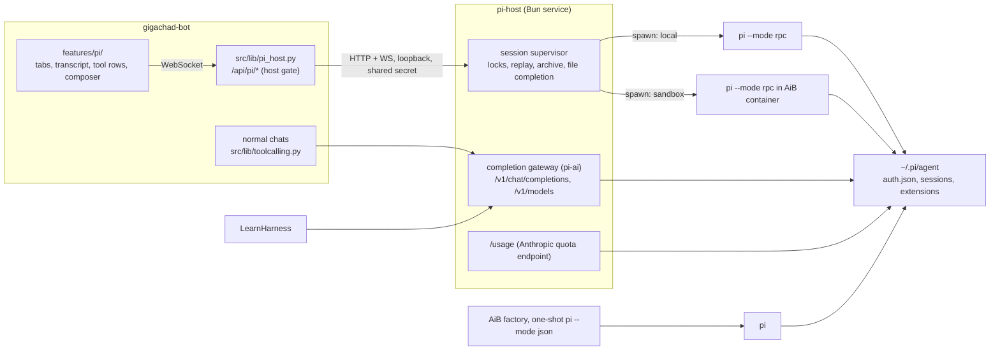

# Pi migration

Moving gigachad-bot from OMP and omp-web to Pi. Decision and rationale: [ADR 0003](adr/0003-pi-as-agent-runtime.md) (why Pi, rejected options, pi-host as a separate Bun service, one adapter per side, Pi pinned). This file owns the contracts, decisions and open phases until the migration is done, then its lasting parts move into `.docs/architecture.md` and this file is deleted.

## Status

| Phase | State |
|---|---|
| P0 spikes, P1 pi-host sessions, P3 workbench, P4 gateway, P6 extensions, P7 LiteLLM out | done |
| P2 coding tabs | **open**: prompt-cache miss notices |
| P5 Agents-in-a-box | **open**: F9 (session lineage via `new_session` with `parentSession`) |

Done phases in one line each:

- **P0**: spikes for the gateway, Pi over stdio in an AiB container (D5, M1, M6) and usage meters.
- **P1**: supervisor, `coding` profile, `src/lib/pi_host.py`, `/api/pi` WS proxy, resync, `Host` seam.
- **P3**: `document` profile (D9); workbench chats run on Pi sessions opened with the chat drawer, linked in `workbench/chats.json`; `.omp/` mirroring, `ompweb-overlay/`, `features/omp/` and the omp-web gate removed.
- **P4**: completion gateway, `thinking_blocks` round trip in `src/lib/toolcalling.py`, reasoning levels from `/v1/models`, `/usage`, production unit on port 8301 (M14).
- **P6**: `pi-extensions/` loaded into `coding` sessions (`-e`); no runtime use of the `omp` binary remains. Compatibility that still runs: legacy tab and catalog rewrites, omp-era manifests, retiring old units in `deploy/install-systemd-service.sh`.
- **P7**: backend completions through `src/lib/completions.py` (openai SDK on the gateway, `gateway_model_id`), LearnHarness on the gateway with the gateway-only token, Ollama through a generated Pi custom provider, unserved models listed as unavailable. LiteLLM, `langchain-litellm`, `llm-baseclient`, `llm_resilience.py`, the gpt-researcher shim and table `model_reasoning_levels` are gone. Stored `litellm_proxy/` selector prefixes stay, translated at the call edge.

### P2 (open)

Delivered: Pi tab kind, sidebar sessions per repo and mount (worktrees grouped under their main repo), Alt+A picker with full-text search, per-session running / waiting on a dialog (M3) / unread / context usage and cost, project selector, drafts, `/memorize`, model and thinking selector (D10), branching (D11), M7, M9, M24, M25, F2, F2b, F3-F8, composer chips, notifications, smooth streaming. Still needed: prompt-cache miss notices.

### P5 (open)

Delivered: `pi --mode json` runner, seeded agent dir, `.factory/agents/` (D12), `agent-sandbox pi-rpc`, `sandboxed` profile with a gateway-only token (D17), `sandbox_model` (D14). Still needed: F9, session lineage for sessions spawned from a session (AiB tasks).

## Architecture



```text
pi-host/                    Bun service, owns everything that talks to Pi
  supervisor                one pi --mode rpc child per open session, profiles, locks, replay, idle eviction
  gateway                   OpenAI-compatible completions over pi-ai, Pi's model registry
  usage                     Anthropic subscription quota from /api/oauth/usage, via pi-usage-meters' tokenFor/getJson
src/lib/pi_host.py          backend adapter: pi-host URLs, shapes, secret; nothing else knows them
src/backend/routes/pi.py    /api/pi/*: host gate, WS proxy, maps pi-host errors (503 unavailable, 502 bad shape)
src/frontend/features/pi/   the only frontend code that knows Pi's protocol
  types.ts                  Pi records the UI reads
  usePiSession.ts           attach, replay, commands, extension dialogs
  transcript.ts             events -> transcript
  tools/                    tool-call rows (ported from omp-web)
```

Pi credentials are host secrets: `src/lib/host_access.py` blocks `~/.pi/agent/auth.json` and the pi-host token, the LearnHarness unit hides both (`run-learnharness.sh`).

Stays outside the migration: LearnHarness (own engine on the Pi SDK, ADR 0001), `packages/chat-ui`, the chat tool loop (`src/lib/toolcalling.py`, `tools.py`), the chat sandbox (staged workspace per turn, no Pi equivalent), memory, research, prompt store, factory, terminal, Neovim, Jupyter.

## Decisions

Rationale for D1, D2, D6, D7 and the choice of Pi is in the ADR.

| # | Decision |
|---|---|
| D1 | One `pi-host` service in Bun: session supervisor, completion gateway and usage. Separate from uvicorn, so backend reloads and workers never end a run |
| D2 | Sessions are `pi --mode rpc` child processes (process isolation, per-session cwd, same transport in a container), not in-process SDK sessions |
| D3 | Supervisor contract: list sessions per cwd from Pi's session files, create or resume with a profile, attach over WS (snapshot then live events, several clients), runs continue without a client, idle children are evicted, session files are never deleted |
| D4 | Profiles are a parameter: `coding` (defaults), `document` (workbench: the user's Pi with `--append-system-prompt`; a request's tool allowlist restricts it to `--tools <list>`, `--no-skills`, `--no-extensions`, `--no-prompt-templates`, `--no-approve`), `sandboxed` (`coding` spawned through AiB) |
| D5 | AiB integration is a spawn strategy. pi-host spawns `agent-sandbox pi-rpc --profile … --cwd … --session-dir … -- <pi args>`, which `exec`s `docker run -i --rm` with AiB's hardened flags: same stdio, stdin-EOF and SIGTERM contract as a local `pi --mode rpc` (spike: about 1 s cold start, no orphans). Workspace and session directory are bind-mounted at their host paths, so session `cwd` and listing match local sessions. Pi's install directory is mounted read-only (glibc-only binary plus sibling assets). The sandboxed Pi reaches models only through the pi-host gateway (AiB host service, custom provider), so no Anthropic credential enters the container. Factory one-shot runs use `pi --mode json` instead of `omp --print` |
| D6 | The backend is the gatekeeper: only `src/lib/pi_host.py` knows pi-host, host access gates `/api/pi/*`, the browser never reaches pi-host |
| D7 | The UI renders Pi natively in `features/pi/`: no iframe, overlay, seam patch or postMessage protocol |
| D8 | Normal chats keep the completion API, served by the pi-host gateway through an OpenAI-compatible client (LiteLLM removed in P7) |
| D9 | The `document` profile passes its system prompt explicitly, appended to Pi's own, it does not rely on Pi's project trust for `.pi/SYSTEM.md`. Workbench chats send no allowlist, so they get the user's full Pi (web, bash, extensions, `AGENTS.md`). Restriction stays a per-request option |
| D10 | Model and thinking are per session. The selector lists Pi's models (`get_available_models`) with Pi's default preselected, new sessions start at thinking `medium` |
| D11 | Branching works like chat branching: each turn's branch action forks into a new session (Pi `fork` at that prompt, or `clone` at the end) that opens in the tab |
| D12 | Factory agent definitions live in `.factory/agents/` (formerly `.omp/agents/`) |
| D13 | Only Anthropic (subscription) and API-key providers. No Codex |
| D14 | The `omp_model` setting is renamed `sandbox_model`, stored defaults migrate on load |
| D15 | No GitHub tool port. Agents use `gh` through bash |
| D16 | The gateway serves only providers Pi knows. A model on a provider Pi cannot serve fails at send with a clear error. Ollama runs through a Pi custom provider generated from `ollama list`, the app no longer autostarts `ollama serve` |
| D17 | Sandboxed Pi (AiB one-shot runs and the `sandboxed` profile) gets a gateway-only token, accepted only on `/v1/*`, never the full pi-host token |

## Gateway

- **Credentials:** `ModelRuntime.create()` from `@earendil-works/pi-coding-agent`, the same version as the pinned Pi: Pi's registry, `auth.json` locking and token refresh, shared with running Pi processes. `pi-ai` alone has no file-backed store. The same runtime serves `/usage`
- **Tools:** OpenAI JSON Schema passes through unchanged, no TypeBox. `tool_choice` supports only `auto` and `none`, `required` or a named function degrade to `auto`. `temperature` is dropped while thinking is on
- **Thinking:** `reasoning_effort` is clamped per model. `/v1/models` lists each model's `thinking_levels`. Signed `thinking_blocks` go out next to `reasoning_content` (a stream chunk with blocks only also carries `reasoning_content: ""`, LiteLLM drops it otherwise). `src/lib/toolcalling.py` must collect `delta.thinking_blocks` and send them back, else turns after a tool call run without thinking
- **Errors:** upstream status is parsed from `pi-ai`'s error text and kept (400, 404, 429). The first stream event is awaited so an early error gets a real status. `Retry-After` is lost, `pi-ai` does not retry
- **Models:** filtered to D13's providers, the runtime otherwise lists every provider with a key in the environment
- **Subscription identity:** `pi-ai` alone sends the OAuth token as a third-party client ("Third-party apps now draw from extra usage"), so `anthropic/*` chat completions go through the OMP gateway (`pi-host/src/gateway/omp.ts`): `omp auth-gateway` shapes them as OMP did before the migration. pi-host starts `omp auth-broker` (127.0.0.1:8765) and `omp auth-gateway` (127.0.0.1:4000) on first use, reuses ones already listening and stops its own on exit. `/v1/models` and every other provider stay on Pi. Inactive without `omp` on PATH and `~/.omp/agent/agent.db`. `PI_HOST_OMP_GATEWAY=0` opts out, `PI_HOST_OMP_BROKER_BIND` / `PI_HOST_OMP_GATEWAY_BIND` move the ports
- Bun's idle timeout is off (`idleTimeout: 0`), else silent non-stream turns are cut

## Supervisor rules

Reference implementation for M2, M18, M22-M25, notifications and streaming: `~/git/ompweb_original` (omp-web, MIT). Port its logic, adapt to Pi's records.

| # | Rule |
|---|---|
| M1 | One writer per session file. Pi does not lock session files (spike: two writers forked the tree silently), so pi-host holds `flock(2)` on the session file (via `bun:ffi`, compatible with the `flock` command) for the child's lifetime, local or sandboxed. Resume opens `--session <path>` after locking, never `--continue`. The Pi TUI is the one writer it cannot see. A held file is refused (409 `locked`) |
| M2 | Replay and resync (after omp-web's "Reconnect and foreground catch-up", `~/git/ompweb_original/DESIGN.md`). Pi never persists a streaming assistant message: pi-host buffers the current turn's events since `message_start` and replays them after the snapshot. Resync takes the last entry id as cursor and answers `mode: append \| replace`: `replace` when compaction or a fork changed the prefix or the cursor entry no longer exists, which a plain `get_entries` since cannot express. A live `message_end` has no durable entry id, so it triggers a catch-up instead of an append (no duplicates when the event and the file read race). The optimistic user prompt and streaming text stay apart from confirmed history |
| M3 | Open extension dialogs, `setStatus` lines and the queue are session state, replayed on attach. A run waiting on a dialog shows as needing the user |
| M4 | No code-reload watcher on pi-host: a restart waits until no session runs, or asks. Distinct from the sessions-directory watcher (M25) |
| M5 | Loopback is no boundary (any page can open a WebSocket to `127.0.0.1`): pi-host requires a shared secret from the backend and checks `Origin` |
| M6 | Children get an allowlisted environment, backend secrets never reach an agent. Sandboxed children get a seeded, writable agent-dir copy (`settings.json`, `npm/`, no `auth.json`): Pi crashes on a read-only agent dir, and a root process in the container could read a mounted credential |
| M7 | `@` file completion: pi-host endpoint per cwd, `git ls-files` plus untracked files, fuzzy ranked (`pi-host/src/catalog/files.ts`) |
| M9 | Archive and restore: pi-host moves session files to an archive folder and back |
| M13 | pi-host runs whatever Pi is installed (mise updates it), `redeploy.sh` restarts it when `pi --version` changes |
| M14 | Production: own systemd unit, `redeploy.sh` restarts pi-host only when its code or the Pi version changed |
| M15 | Tests use `pi-ai`'s faux provider, never a real model |
| M16 | pi-host forwards Pi's records unchanged plus a small envelope (attached, replay start and end, lock held, exit) carrying `{streamId, sequence}`. `streamId` changes when the child or the session identity changes, so the client drops its live state. The backend proxies without parsing |
| M17 | Idle eviction asks extensions first. Pi has no liveness registry over RPC, so an extension with background work (subagents, background tasks) sets a non-empty `setStatus` under the key `session-liveness` and clears it when done. Eviction also skips pinned, attached, running, compacting and dialog-waiting sessions |
| M18 | One browser WebSocket carries every open Pi session (session ids in the envelope). A socket per tab exhausts HTTP/1.1's six connections per host next to terminals, Neovim and file watches. omp-web's per-session and pooled sockets failed (`~/git/ompweb_original/docs/specs/2026-10-31-browser-transport-experiment-design.md`): command acks queued behind event frames, the ack timeout killed healthy sockets, every redial replayed full snapshots. So liveness never depends on command-ack latency: no ack timeouts on the shared socket |
| M19 | Private session state: a small revisioned record per session next to its file (UI choices, draft, extension card state), copied on fork |
| M20 | Pin protects a session from idle eviction and automatic archiving, separate from archive (M9) |
| M21 | Every attached client may steer and abort. A controlling-client lease is added only if two tabs fighting becomes a real problem |
| M22 | One resync at a time: reconnect, `visibilitychange`, `online` and a settled run all request a resync, a guard collapses them into one request in flight plus at most one follow-up, so a late response never applies stale state (`~/git/ompweb_original/lib/reconcile-guard.ts`) |
| M23 | One machine interface: every machine-local action (spawn local or AiB, session file ops, listing, file completion) goes through one `Host` interface with a fixed operation list and no generic exec. The local machine uses it too, so "Remote machines" only adds a transport (`~/git/ompweb_original/DESIGN.md`, "The Host seam") |
| M24 | Full-text session search in pi-host next to M7: searches transcripts, cache by file version, parses 4 files at a time (`~/git/ompweb_original/lib/session-content-search.ts`). Feeds the Alt+A picker. Hits are addressed `(entryId, ordinal)`, the ordinal counting the entry's match spans in text order: `GET /search` lists a session's best 3, `GET /sessions/:id/matches?q=&limit=` its ranked list (`{matches, total}`, quality, then later entries first) |
| M25 | Sessions-directory watcher: pushes `sessions_changed` to attached clients, so sessions written by the Pi TUI update live in the sidebar (`~/git/ompweb_original/lib/session-watcher.ts`) |
| M26 | Auto-resume (opt-in, off by default, setting `autoResume` in `<state dir>/pi-host-settings.json`, shown as "Resume interrupted sessions" in the gigachad settings through `GET/PUT /api/pi/settings`): each pi-host writes `active-runs-<pid>.json` (`{ownerPid, ownerStart, sessions:[{sessionId, sessionPath, cwd, spec}]}`, temp file + rename) next to the token files on `agent_start` and removes the record on `agent_settled`, a client `abort`, or a child ending by itself (not on pi-host shutdown: that run is interrupted). On start (`resumeInterrupted`, `pi-host/src/supervisor/resume.ts`) pi-host claims the lists of dead owners (pid gone, or `/proc` start time + boot id differ: pid reuse and reboots are safe), renaming each first so only one pi-host wins, and always deletes them. With the setting on it starts each session through the normal start path (so a locked, archived, factory or already live session is skipped) and sends `The session was interrupted by a restart. Continue where you left off.` (`~/git/ompweb_original/lib/session-resume.ts`, `process-identity.ts`) |
| M27 | Subagent roster: pi-host keeps open `setWidget` text widgets per session (`ui.widgets` in `attached` and `resync`, except the transient `subagent-inspect` reply). The shell (`features/pi/subagents.ts`, `SubagentRoster.tsx`) folds two sources of the user's pi-subagents extension, which stays unmodified: the `subagent-async` widget (`PI_SUBAGENT_ASYNC_JSON:` snapshot: background children, agent, state, current tool, times, no tokens or cost) and the `subagent` tool call's `details` (`progress[]`, `results[]`: foreground children with tokens and cost). The fleet widget is a TUI component, RPC drops it. A row opens its task, transcript window and output: background children through `/subagents-inspect-rpc` (an inline extension command sent as a `prompt`, the reply arrives on the `subagent-inspect` widget, matched by `requestId`), foreground ones from what their tool call reported. Finished children stay until dismissed or the next run starts |

## Pi features in use

| # | Feature | Use |
|---|---|---|
| F1 | `get_entries` with `since` cursor | Resync after reconnect or pi-host restart, multi-tab attach |
| F2 | `custom` messages (`customType`, `details`) and `entry_appended` | UI extension point: a registry of `customType` -> React card, e.g. the video paste preview |
| F2b | Tool renderer registry | `registerToolRenderer(toolName, (call, run, next) => …, { placement })`: a renderer replaces the default tool row, wraps it (`next()`), or passes per call. `standalone` keeps it outside the folded "Process details" (todos, plans, questions). With F2 this is how an extension gets native UI. After pi-web.dev's `resolve(toolName, next)` chain |
| F3 | `get_session_stats` | Context window, tokens and cost next to the composer |
| F4 | `steer` vs `follow_up`, `set_steering_mode` | Enter steers, Alt+Enter queues a follow-up |
| F5 | `clear_queue` then `abort` | Esc restores queued text into the draft |
| F6 | `fork`, `clone`, `get_fork_messages`, `get_tree` | Branching (D11) |
| F7 | `bash` with `excludeFromContext` | `!cmd` and `!!cmd` from the composer |
| F8 | `compact` with `customInstructions`, `set_auto_compaction` | Steered compaction, compaction card |
| F9 | `new_session` with `parentSession` | Lineage for sessions spawned from a session (AiB tasks); **open** (P5) |
| F10 | `get_available_models`, `set_model`, `get_available_thinking_levels`, `set_thinking_level` | Per-session model and thinking (D10) |
| F12 | `export_html` | Export a session |

## UI behavior

- **Composer chips** (shared by Pi tabs and normal chats, `src/frontend/features/chat/composer/ChatInput.tsx`): labeled, removable text staged above the draft, appended verbatim on send, kept per conversation, sendable without typed text. Sources: a large paste (above a size threshold), a file panel selection, a diff hunk, test output, a canvas or PDF region, an extension's context.
- **Notifications** (`~/git/ompweb_original/docs/specs/2026-10-06-notifications-design.md`): in-page system notifications, no Web Push (needs HTTPS and a service worker). "Finished" fires on `agent_settled`, not `agent_end` (background work and queued follow-ups done too), "Waiting for your answer" on a dialog request (M3), "Run failed" once per run. Tag `sessionId:type`, a repeat replaces the previous one. Nothing for the session in view, nothing for subagent or aborted runs.
- **Smooth streaming**: Pi `message_update` records are delta-only on the wire (no cumulative `message`, no `partial`), pi-host forwards them as is, `applyStreamUpdate` is the pure reducer, `features/pi/coalescer.ts` batches them per animation frame (50 ms timer in a hidden tab). Model: `~/git/ompweb_original/lib/message-update-coalescer.ts`, and `~/git/ompweb_original/lib/chat-transcript-plan.ts` (group rows in one pass, create elements only for the visible window).
- **Entry edits**: `context_edit` (omit or replace an earlier message) and `label` entries arrive after the entry they target, also via resync `append`. The transcript applies them to their target (or marks the edited message) instead of rendering rows. A failed attempt Pi's auto-retry omitted (assistant, `stopReason:"error"`, `context_edit` `replacement:null`) shows only as a quiet "Retried after: <error>" line, other omitted messages keep "Omitted from context" (`features/pi/PiTranscript.tsx`).

## Extensions

| Extension | Plan |
|---|---|
| `files` (`pi-extensions/`, from `~/.omp/agent/extensions/files.ts`) | Record `edit`/`write` targets per session, `/files` selects one. In RPC mode it emits the path for the shell to open in the file panel, in the TUI it hands the terminal to `$EDITOR` (`ctx.mode === "tui"`) |
| `context-usage` (`~/.pi/agent/extensions/context-usage.ts`) | `ctx.getContextUsage()` into a `setStatus` line, for the TUI. The shell's own meter uses `get_session_stats` (F3) |
| Video paste (`~/.pi/agent/extensions/video-paste.ts`) | An input handler turns an `@…/pastes/<video>` mention into up to 8 frames picked at scene changes (ffmpeg) plus metadata and emits a preview `custom` message (F2), with `POST /api/pi/pastes` and the `video-preview` card |
| `pi-usage-meters` | pi-host depends on it (pinned `0.6.4`, not installed in Pi). Its core renders text only, so pi-host calls `GET /api/oauth/usage` itself with the core's `tokenFor`/`getJson` and maps `limits[]` to the backend's report shape: session -> `5h`, weekly -> `7d`, a model-scoped weekly limit keeps its model label. One process-wide cache, the backend keeps its stale-report fallback (429s carry no numbers) |
| JS tool | Pi's built-in `codemode` package (`defaultTools`) |
| `rmodel`, `herdr-omp-agent-state` | Dropped |

## Open risks

- Pi does not lock session files: the Pi TUI is a writer pi-host cannot see (M1).
- The `/api/oauth/usage` endpoint is undocumented.
- `Retry-After` is lost in the gateway; `pi-ai` does not retry.
- Subscription chat completions depend on the `omp` binary and `~/.omp/agent/agent.db` (Gateway, "Subscription identity").
- Restarting pi-host ends running turns (ADR 0003).
- Two tabs steering one session may need a controlling-client lease (M21).
- Pi is pinned, upgrades are deliberate (ADR 0003); M13 restarts pi-host when `pi --version` changes.
- Old OMP sessions stay in place, reachable through the `omp` CLI, nothing is converted (ADR 0003).

## Future

- Extension-driven composer: `set_editor_text` and the `editor` dialog let an extension prefill or edit the draft (F11).
- Session lineage view for AiB tasks (F9) beyond a parent link.
- Scheduled agent sessions in pi-host (cron-style Pi jobs).
- Private input: a form that writes a secret to a file without it entering the conversation.
- **Remote machines** (e.g. the GPU servers `cool-frog`/`cube1`): one pi-host per machine, the backend adapter picks it by machine id, the UI is unchanged. Take the design from pi-web.dev (`jmfederico/pi-web`, MIT), which already runs remote session daemons behind one UI gateway (its docs: "Remote access", "Machines").
  - Transport: an SSH tunnel to the remote pi-host, like the remote OCR/Ollama tunnels (`.docs/remote-inference.md`)
  - Credentials stay local: the remote Pi uses the local gateway through a reverse tunnel, as sandboxed sessions do (D5)
  - Everything that touches files runs on that machine's pi-host: session listing, `@` completion (M7), archive (M9), and the file panel needs a remote read/write path
  - Keep pi-host's contract free of host-only assumptions: sessions are addressed by machine plus id, paths are the machine's own

## Considered and rejected

- **A pi-web plugin adapter** to reuse community plugins: the pi-web.dev ecosystem has about 20 packages (hundreds to about 2k monthly downloads each, few authors), its host API (Lit renderers, panels, server capabilities) is large, and its plugins carry pi-web's look. The value sits in Pi packages (14k on npm), which already run inside the RPC child, their UI gets F2 and F2b components instead.
